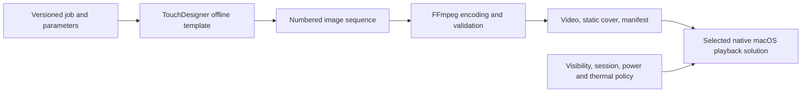

# Dynamic Wallpaper with TouchDesigner

Research and tooling for low-overhead macOS dynamic wallpapers: TouchDesigner video generation, native playback, and reproducible performance benchmarks.

The project aims to turn procedural TouchDesigner artwork into repeatable, seamless video loops that can run as a macOS desktop background without keeping TouchDesigner open. Memory, CPU, GPU, and power costs are design constraints and release criteria.

**Current stage: research, measurement prototypes, and implementation planning.** There is no finished wallpaper application or automated TD template yet. The native playback probe works, but whole-system performance has not passed the proposed acceptance gate. Product implementation follows review of the [complete plan](plan/README.md); independent Claude review is pending.

## What we are going to build

- One parameterized TD visual template with fixed seeds and frame-based animation.
- A serial job pipeline that exports numbered frames, encodes a local video, and validates the result before publishing an asset bundle.
- A lightweight macOS playback solution, selected by comparing an existing application with a minimal native reference under the same tests.
- Reliable pause, static fallback, resource release, and recovery when animation is unnecessary or restricted by power/session policy.
- Reproducible measurements that include the player, relevant helpers, WindowServer, and the system GPU—not just the application's headline CPU number.

The initial profile is one screen, 1280×720 at 24 fps, SDR, H.264, and no audio. A 1920×1080 profile is conditional on the TD license and measured playback cost. Slow-moving artwork may also get a 15 fps rendition. Higher resolutions, multiple animated displays, HDR, real-time interaction, and private native wallpaper extensions are later decisions.

## Why separate generation from playback?

TouchDesigner is the authoring and offline rendering environment. A finished video lets ordinary playback avoid recalculating the original procedural scene or running the editor, render controller, and encoder continuously.



The playback implementation remains a decision to make after controlled measurements. Existing applications provide useful mechanisms, but their marketing claims and our small probe cannot substitute for testing the actual selected solution.

## What has been verified

| Area | Evidence | Status |
|---|---|---|
| Wallpaper mechanisms | Apple documentation; desktop-window, dynamic HEIC, and private provider alternatives | Researched |
| Existing applications | Pinned source review of LiveDesk, Aerial, and Mural | Source-reviewed; those applications were not locally benchmarked |
| Native playback | Four approximately 60-second AppKit/AVFoundation probe runs | Playback, looping, pause, and one-screen occlusion recovery observed |
| Encoding tooling | FFmpeg image-sequence encode and full decode checks | Small synthetic fixture validated |
| TD automation | Official API, export, timing, and license research | No TD template built or rendered yet |
| Whole-system resource budgets | Noisy GPU baseline; helper-memory attribution incomplete | **Not accepted** |
| Long-term stability and complete desktop lifecycle | Sustained runs, actual lock/sleep, Spaces, and display changes | Pending |

On the tested Apple M5 Max / macOS 27.2.1 system, the 1080p24 probe process used about **1.53% CPU while playing and 0.06% while paused**, where 100% means one fully used logical core. Its RSS was about **69 MiB** in both states. These are short-run, process-only observations. They exclude the cost of WindowServer and system decoder services, and they do not demonstrate low total GPU or power use. Pausing reduced CPU work but did not immediately release retained memory.

See the [performance report](research/05-performance-feasibility.md) for methodology, limitations, proposed budgets, and links to sanitized measurements. The [source comparison](research/04-existing-apps-performance.md) explains which existing-player behaviors are useful and which require further validation. Most detailed research notes are in Chinese; this README and the implementation plan are in English.

## Resource policy and acceptance

The proposed defaults are:

1. Generate and transcode offline; close TD during ordinary playback.
2. Encode genuine low-frame-rate renditions at normal playback speed.
3. Pause when the selected desktop is fully occluded; add approximate coverage rules only if their benefit justifies the monitoring cost.
4. Use a static state on battery and in Low Power Mode; handle thermal, sleep, and session conditions as independent pause reasons.
5. Keep a frame during a brief pause; investigate releasing the movie pipeline after a longer pause.
6. Avoid permanent performance sampling or per-frame scripting in the shipped playback path.

Initial proposed budgets include a whole-playback CPU increment of at most 5 percentage points of one core, a 200 MiB footprint budget for the player and attributable helpers, a separate WindowServer footprint increment of at most 64 MiB, and a measured GPU increment of at most 3 percentage points using a fixed same-machine method. Sustained memory growth or added memory pressure also prevents acceptance; shared memory must not be counted twice by simply adding these budgets. These are project targets, **not verified results or cross-machine guarantees**. Measurement noise or missing attribution makes a result inconclusive. The exact protocol and release conditions are in [the plan](plan/README.md#8-performance-acceptance).

## Repository layout

```text
.
├── README.md                 Project purpose, status, and entry points
├── AGENTS.md                 Shared workflow and milestone reporting rules
├── CLAUDE.md                 Entry point for Claude's review and collaboration
├── plan/
│   └── README.md             Milestones, architecture decisions, risks, acceptance
├── research/
│   ├── README.md             Research index
│   ├── 01-...md … 05-...md   Mechanisms, TD automation, sources, measurements
│   └── benchmarks/
│       ├── WallpaperProbe.swift
│       ├── measure.py
│       ├── summarize.py
│       ├── sanitize_results.py
│       ├── results/          Reviewed, sanitized public evidence
│       └── results_private/  Local original/new runs; ignored by Git
└── agents_shared/
    ├── README.md             Report naming, checkpoints, and handoff protocol
    └── [agent][date-time].md  Append-only milestone/review reports
```

Build outputs, fixture movies, credentials, caches, and private measurements are excluded from version control. Public measurement copies preserve numerical observations while normalizing local paths, process identifiers, and wall-clock metadata; see [data-publication notes](research/benchmarks/results/2026-11-10/SANITIZATION.md).

## Explore and reproduce the research

Start with [the research index](research/README.md), then [the implementation plan](plan/README.md). To run the current probe, use a logged-in macOS graphical session, Xcode Command Line Tools, Python 3, and FFmpeg/ffprobe with `libx264`. TouchDesigner is not needed for this synthetic playback test.

From the repository root:

```sh
mkdir -p research/benchmarks/build research/benchmarks/fixtures

xcrun swiftc -O \
  -module-cache-path /private/tmp/wallpaper-probe-swift-cache \
  research/benchmarks/WallpaperProbe.swift \
  -o research/benchmarks/build/WallpaperProbe \
  -framework AppKit -framework AVFoundation -framework CoreGraphics

ffmpeg -hide_banner -n -f lavfi -i 'testsrc2=size=1920x1080:rate=24' \
  -t 4 -an -c:v libx264 -threads 4 -preset fast -crf 20 \
  -pix_fmt yuv420p -movflags +faststart \
  research/benchmarks/fixtures/1080p24.mp4

python3 research/benchmarks/measure.py \
  --probe research/benchmarks/build/WallpaperProbe \
  --video research/benchmarks/fixtures/1080p24.mp4 \
  --output-dir research/benchmarks/results_private/local/1080p24 \
  --schedule idle:10,play:25,pause:15,idle:10

python3 research/benchmarks/summarize.py \
  research/benchmarks/results_private/local
```

The measurement command opens a temporary click-through desktop-level window, runs for approximately 60 seconds, cleans up, and exits. It retains the existing system wallpaper configuration. Choose a new output directory for a repeat run; the tool refuses to overwrite a run. The source fixture is not a finished artistic loop or a complete color-management example.

Read [the benchmark guide](research/benchmarks/README.md) before interpreting output. In particular, at-least-partial visibility is not full-desktop visibility, process RSS is not total memory, and global GPU utilization is not attributable process GPU usage. The current bounded probe is for short experiments; the longer controlled protocol is a planned harness improvement.

For TD work, the locally researched build is 2025.33230 and the actual license is not yet confirmed. Non-Commercial has resolution and usage restrictions; external encoding does not remove them. Consult [TD research](research/02-touchdesigner-video-automation.md) before choosing an export profile.

## Planned milestones

| Milestone | Result |
|---|---|
| M0: Research and review | Public documentation, sanitized evidence, reviewed plan, shared agent reports |
| M1: Measurement quality | Controlled baselines, reliable attribution/timestamps, bounded sustained-run tooling |
| M2: Performance gate | Accepted playback profile and a recorded reuse-versus-build decision |
| M3: TD asset production | One deterministic template, validated job pipeline, reproducible video bundle |
| M4: Playback integration | Minimal host or existing-player integration with tested pause and recovery policies |
| M5: Sustained validation | Long-run memory and lifecycle evidence, truthful compatibility and release notes |

See [the complete plan](plan/README.md) for each milestone's deliverables, exit criteria, failure handling, and open questions. Product work does not start as part of this repository-publication task.

## Review and agent collaboration

Read [AGENTS.md](AGENTS.md) and the latest reports under [agents_shared](agents_shared/README.md) before taking over work. Review the planned milestone before implementation, record findings and their resolution, and report at meaningful checkpoints. Reports use the literal filename form `[agent_name][YYYY-MM-DD_HH-mm-ss±HHMM].md`; this assistant uses `gpt6astra`.

Claude's independent plan review is expected but has not been performed by this assistant. The handoff should focus on measurement validity, aggregate resource accounting, pause-state correctness, lock/sleep assumptions, TD reproducibility, and scope. Review reports must identify what was actually examined and tested.

## Licensing and provenance

A project license has not yet been selected; this repository currently makes no additional reuse grant. Third-party projects and documentation retain their own licenses. Source references are attributed in the research, and no third-party wallpaper videos are bundled. Choose and document a license before redistributing a derived application or accepting code under a required licensing policy.
