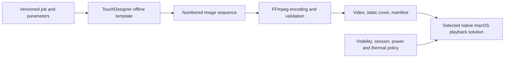

# Dynamic Wallpaper with TouchDesigner

Build a low-overhead macOS wallpaper app with agent-assisted creation, editable TouchDesigner templates, and data-driven effects, plus a shared Claude/Codex authoring skill.

The first playback path turns procedural TouchDesigner artwork into repeatable video loops that run without TD. The expanded product also targets live visual properties, user-selected APIs, and optional real-time renderers. Memory, CPU, GPU, and power costs remain design constraints and release criteria for each mode.

The final deliverables are **a wallpaper app whose default playback starts and runs with TouchDesigner closed**, and **an agent skill that turns a user's requirements into verified wallpapers**. Inside the app, users should be able to connect a model provider, generate artwork through the skill, open an editable TD template on request, and bind effects to weather or custom APIs. Optional TD live modes declare their runtime/license dependencies. The [expanded platform plan](plan/agent-platform.md) and [feature feasibility research](research/06-interactive-agent-platform.md) distinguish these targets from implemented code. Research, probes, and synthetic fixtures are intermediate deliverables.

**Current status and review decisions:** see [the shared project status](agents_shared/README.md#current-review-state). This README describes the intended system and the evidence below; it does not substitute for performance acceptance. The [complete plan](plan/README.md) and [Claude implementation prompt](plan/claude-implementation-prompt.md) define the coding handoff.

## Run the local app

The native **Wallpaper Studio** development preview is implemented in [`app/`](app/README.md):

```sh
python3 app/build_app.py
open 'app/build/Wallpaper Studio.app'
```

It imports validated wallpaper bundles, plays a muted video with TD closed, keeps a static cover under the power policy, and provides menu-bar controls. Explicit creation can run the calibrated TD template and import the result; this complete app-to-TD-to-library workflow has been exercised. Optional pages provide model proposals using the shipped skill, editable TD copies, Los Angeles weather and typed custom HTTPS data. Read [the app guide](app/README.md) for dependencies, credentials, supported inputs and validation limits.

This is an ad-hoc-signed local preview. Actual model-provider requests, full desktop lifecycle tests, sustained whole-system performance acceptance and broader Wallpaper Engine features remain open; the preview is not a finished public release.

## What we are going to build

- One parameterized TD visual template with fixed seeds and frame-based animation.
- A serial job pipeline that exports numbered frames, encodes a local video, and validates the result before publishing an asset bundle.
- A lightweight macOS playback solution, selected by comparing an existing application with a minimal native reference under the same tests.
- Reliable pause, static fallback, resource release, and recovery when animation is unnecessary or restricted by power/session policy.
- Reproducible measurements that include the player, relevant helpers, WindowServer, and the system GPU—not just the application's headline CPU number.
- A versioned skill for Claude/Codex that reuses known user preferences, clarifies missing creative requirements, and guides the complete authoring-to-app workflow.
- On-demand agent creation with user-supplied provider credentials, bounded local tools, and editable TD templates.
- Data connectors and visual-property bindings, starting with a [Los Angeles weather design example](examples/weather-los-angeles/README.md).
- A staged Wallpaper Engine feature matrix for scenes, Web, audio/mouse input, multiple screens and playlists; Workshop/project compatibility is a separate investigation.

The initial profile is one screen, 1280×720 at 24 fps, SDR, H.264, and no audio. A 1920×1080 profile is conditional on the TD license and measured playback cost. Slow-moving artwork may also get a 15 fps rendition. Live interaction, data bindings and multiple screens are later planned increments, with independent renderer/dependency/resource validation. HDR and private native wallpaper extensions remain separate decisions.

## Why separate generation from playback?

TouchDesigner is the authoring and offline rendering environment for the first mode. A finished video lets ordinary playback avoid recalculating the procedural scene or running production tools continuously. The diagram below describes that mode; the expanded plan adds an on-demand agent coordinator, a data broker, and optional live renderers. Ordinary weather refreshes update data/properties without repeatedly calling a model or exporting a new movie.



The preview uses our own public AppKit/AVFoundation host, selected in [ADR 001](plan/adr-001-native-preview.md) after screening the pinned existing-player sources. Controlled measurements still gate release acceptance; this choice is not a benchmark ranking of those applications.

## What has been verified

| Area | Evidence | Status |
|---|---|---|
| Wallpaper mechanisms | Apple documentation; desktop-window, dynamic HEIC, and private provider alternatives | Researched |
| Existing applications | Pinned source review of LiveDesk, Aerial, and Mural | Source-reviewed; those applications were not locally benchmarked |
| Native playback | Four approximately 60-second pilots; a new 30-second schema-2 harness smoke | Playback, looping, pause, and one-screen occlusion recovery observed; controlled acceptance pending |
| Encoding tooling | Job/sequence validation, FFmpeg encoding, bundle publication, regression tests | Synthetic 720p24 bundle reproduced; cancellation and source-color validation hardened |
| Measurement tooling | Bounded sustained mode, process identity checks, non-root footprint sampling, phase-aligned summaries | 90 tests passed at the M1 checkpoint; later TD report records 93 tests. Sampler overhead and controlled baselines pending |
| TD automation | Batch TD runner, generated template `.toe`, chart/index checks, two real 720p24 480-frame exports | Byte-identical frames and video across two exports; all bundle checks pass. AVPlayer color/loop review pending |
| Product app | Native release build, actual GUI import/apply and app-triggered 480-frame TD generation; two 90-second product smoke runs | Battery static fallback and bounded diagnostic play/pause/release/resume observed; full lifecycle/resource acceptance pending |
| Agent and data features | Typed model proposals, Keychain profiles, safe selected `.env` parsing, weather/custom mapping and portable core checks | Real public weather fetch passed; model transport uses fixtures, no paid provider trial |
| Whole-system resource budgets | Noisy GPU baseline; helper-memory attribution incomplete | **Not accepted** |
| Long-term stability and complete desktop lifecycle | Sustained runs, actual lock/sleep, Spaces, and display changes | Pending |

On the tested Apple M5 Max / macOS 27.2.1 system, the 1080p24 probe process used about **1.53% CPU while playing and 0.06% while paused**, where 100% means one fully used logical core. Its RSS was about **69 MiB** in both states. These are short-run, process-only observations. They exclude the cost of WindowServer and system decoder services, and they do not demonstrate low total GPU or power use. Pausing reduced CPU work but did not immediately release retained memory.

See the [performance report](research/05-performance-feasibility.md) for methodology, limitations, proposed budgets, and links to sanitized measurements. The [source comparison](research/04-existing-apps-performance.md) explains which existing-player behaviors are useful and which require further validation. Most detailed research notes are in Chinese; this README and the implementation plan are in English.

## Resource policy and acceptance

The proposed defaults are:

1. Generate and transcode offline for video modes; close TD during ordinary playback. Optional live modes expose and measure their additional runtime costs.
2. Encode genuine low-frame-rate renditions at normal playback speed.
3. Pause when the selected desktop is fully occluded; add approximate coverage rules only if their benefit justifies the monitoring cost.
4. Use a static state on battery and in Low Power Mode; handle thermal, sleep, and session conditions as independent pause reasons.
5. Keep a frame during a brief pause; investigate releasing the movie pipeline after a longer pause.
6. Avoid permanent performance sampling or per-frame scripting in the shipped playback path.

Initial proposed budgets include a whole-playback CPU increment of at most 5 percentage points of one core, a 200 MiB footprint budget for the player and attributable helpers, a separate WindowServer footprint increment of at most 64 MiB, and a measured GPU increment of at most 3 percentage points using a fixed same-machine method. Sustained memory growth or added memory pressure also prevents acceptance; shared memory must not be counted twice by simply adding these budgets. These are project targets, **not verified results or cross-machine guarantees**. Measurement noise or missing attribution makes a result inconclusive. The exact protocol and release conditions are in [the plan](plan/README.md#8-performance-acceptance).

## Repository layout

```text
.
├── README.md                 Project purpose, status, and entry points
├── AGENTS.md                 Shared workflow and milestone reporting rules
├── CLAUDE.md                 Entry point for Claude's review and collaboration
├── app/                      Native macOS application, build and core checks
├── plan/
│   ├── README.md             Milestones, architecture decisions, risks, acceptance
│   ├── agent-platform.md     Agent APIs, templates, data sources, live renderers
│   └── claude-implementation-prompt.md
├── examples/                 Proposed integration/configuration examples
├── jobs/                     Versioned job schema and example
├── pipeline/                 Sequence validation, encode, bundle publication
├── td/                       Shader/controller sources and TD build guide
├── tests/                    Pipeline and measurement regression checks
├── skills/td-wallpaper/      Shared agent skill and authoring guidance
├── research/
│   ├── README.md             Research index
│   ├── 01-...md … 06-...md   Mechanisms, TD automation, measurements, live platform
│   └── benchmarks/
│       ├── WallpaperProbe.swift
│       ├── measure.py
│       ├── system_metrics.py
│       ├── summarize.py
│       ├── summarize_v2.py
│       ├── sanitize_results.py
│       ├── results/          Reviewed, sanitized public evidence
│       └── results_private/  Local original/new runs; ignored by Git
└── agents_shared/
    ├── README.md             Report naming, checkpoints, and handoff protocol
    └── [agent][date-time].md  Append-only milestone/review reports
```

Build outputs, fixture movies, credentials, caches, and private measurements are excluded from version control. Public measurement copies preserve numerical observations while normalizing local paths, process identifiers, and wall-clock metadata; see the [original data-publication notes](research/benchmarks/results/2026-11-10/SANITIZATION.md) and [schema-2 smoke notes](research/benchmarks/results/m1-2026-11-17/SANITIZATION.md). See the [pipeline guide](pipeline/README.md), [job contract](jobs/README.md), and [TD build guide](td/README.md) for asset production.

## Explore and reproduce the research

Start with [the research index](research/README.md), then [the implementation plan](plan/README.md). To run the current probe, use a logged-in macOS graphical session, Xcode Command Line Tools, Python 3, and FFmpeg/ffprobe with `libx264`. TouchDesigner is not needed for this synthetic playback test.

From the repository root:

```sh
mkdir -p research/benchmarks/build research/benchmarks/fixtures

xcrun swiftc -O \
  -module-cache-path /private/tmp/wallpaper-probe-swift-cache \
  research/benchmarks/WallpaperProbe.swift \
  -o research/benchmarks/build/WallpaperProbe \
  -framework AppKit -framework AVFoundation -framework CoreGraphics

ffmpeg -hide_banner -n -f lavfi -i 'testsrc2=size=1920x1080:rate=24' \
  -t 4 -an -c:v libx264 -threads 4 -preset fast -crf 20 \
  -pix_fmt yuv420p -movflags +faststart \
  research/benchmarks/fixtures/1080p24.mp4

python3 research/benchmarks/measure.py \
  --probe research/benchmarks/build/WallpaperProbe \
  --video research/benchmarks/fixtures/1080p24.mp4 \
  --output-dir research/benchmarks/results_private/local/1080p24 \
  --schedule idle:10,play:25,pause:15,idle:10

python3 research/benchmarks/summarize.py \
  research/benchmarks/results_private/local
```

The measurement command opens a temporary click-through desktop-level window, runs for approximately 60 seconds, cleans up, and exits. It retains the existing system wallpaper configuration. Choose a new output directory for a repeat run; the tool refuses to overwrite a run. The source fixture is not a finished artistic loop or a complete color-management example.

Read [the benchmark guide](research/benchmarks/README.md) before interpreting output. In particular, at-least-partial visibility is not full-desktop visibility, process RSS is not total memory, and global GPU utilization is not attributable process GPU usage. The probe defaults to a 120-second cap; an explicit `--sustained` mode permits finite runs up to 3,600 seconds. The longer controlled protocol remains unrun.

For TD work, the calibrated build is 2025.33230; real export evidence identifies TouchDesigner Non-Commercial. Its resolution and usage restrictions still apply; external encoding does not remove them. Consult [TD research](research/02-touchdesigner-video-automation.md) and [calibration evidence](td/calibration/README.md) before changing a profile or distributing generated media.

## Planned milestones

| Milestone | Result |
|---|---|
| M0: Research and review | Public documentation, sanitized evidence, reviewed plan, shared agent reports |
| M1: Measurement quality | Controlled baselines, reliable attribution/timestamps, bounded sustained-run tooling |
| M2: Performance gate | Accepted playback profile and a recorded reuse-versus-build decision |
| M3: TD asset production | One deterministic template, validated job pipeline, reproducible video bundle |
| M4: Playback integration | Minimal host or existing-player integration with tested pause and recovery policies |
| M5: Sustained validation | Long-run memory and lifecycle evidence, truthful compatibility and release notes |
| M6: Agent workflow | Claude/Codex skill verified from user brief through real TD export and app playback |
| M7–M10: Platform expansion | In-app agent creation, TD editing, API/data bindings, live effects and broader feature coverage |

See [the complete plan](plan/README.md) for deliverables, exit criteria, failure handling, and dependencies. M1 tooling and M3 asset code can be developed independently; GPU-heavy render/encode work and controlled playback measurements must use separate time slots.

## Review and agent collaboration

Read [AGENTS.md](AGENTS.md) and the latest reports under [agents_shared](agents_shared/README.md) before taking over work. Review the planned milestone before implementation, record findings and their resolution, and report at meaningful checkpoints. Reports use the literal filename form `[agent_name][YYYY-MM-DD_HH-mm-ss±HHMM].md`; this assistant uses `gpt6astra`.

Live review status, finding dispositions, and active ownership are maintained only in [the shared project status](agents_shared/README.md#current-review-state). Read each immutable review with its subsequent response. Reports must identify what was actually examined and tested; a completed review is not a completed runtime experiment.

## Licensing and provenance

A project license has not yet been selected; this repository currently makes no additional reuse grant. Third-party projects and documentation retain their own licenses. Source references are attributed in the research, and no third-party wallpaper videos are bundled. Choose and document a license before redistributing a derived application or accepting code under a required licensing policy.
