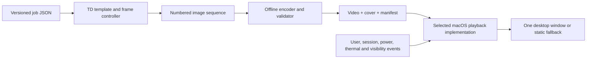

# Implementation plan

Review disposition and current ownership: [shared project status](../agents_shared/README.md#current-review-state). Plan revised 2026-11-19; the [Claude implementation prompt](claude-implementation-prompt.md) records the first coding assignment. [ADR 001](adr-001-native-preview.md) records the native preview decision and preserves release gates.

This plan turns the research into an implementation sequence. The user delegated the review decisions to gpt6astra and requested a coding handoff to Claude. M1 measurement tooling and M3 asset-production code may proceed independently; a performance pass remains a separate requirement for the playback decision and release. The existing Swift program is a measurement probe, not the wallpaper application.

The objective is a macOS wallpaper platform that uses little memory, CPU, and GPU. The first path uses offline TouchDesigner artwork and native video playback; the user's expanded scope adds in-app agents, editable TD templates, live data and optional interactive renderers. See [the platform extension](agent-platform.md) for M7–M10 and renderer-specific dependencies. Performance is a release criterion, not a claim inferred from the words “native” or “hardware accelerated.”

## Final deliverables

The user clarified two final outputs on 2026-11-17:

1. **A usable macOS wallpaper application.** Starting it, selecting an ordinary local video asset, playing, pausing, falling back to a static image, and quitting must work with TouchDesigner closed. Default playback must not start TD, TouchPlayer, a TD automation connection, or an encoder. The expanded app also needs on-demand agent API creation, a template/edit-in-TD workflow, user API/data bindings, and staged interactive feature coverage. Optional live modes declare their dependencies. Deliver a runnable app, clear setup instructions, and measured resource/lifecycle evidence; an existing-player integration may inform or serve the first playback increment but cannot alone satisfy the expanded product. The Swift probe is not this output.
2. **A shared agent skill for Claude and Codex and the app's agent coordinator.** An agent should quickly locate relevant code, recover preferences, clarify missing requirements, choose a suitable video/live/data path, build or adapt a dedicated template, validate the result, and verify the selected runtime. Default video/data-variant modes work with TD closed; optional live dependencies must be stated. Maintain the skill in `skills/td-wallpaper/`; it must not assume private tools, an installed agent CLI, or that a model API can directly operate the computer. A draft skill or synthetic encode alone does not satisfy this output.

The first usable scope remains one screen and one local 720p24 SDR asset, with start/pause/quit, static fallback, and the agreed power/session behavior. Document authoring dependencies separately from app runtime dependencies. M1/M2 establish a defensible playback choice; M3 supplies artwork; M4/M5 deliver the first usable app; M6 validates the authoring skill; M7–M10 deliver the expanded creation/data/interactive platform. Wallpaper Engine feature equivalence is a long-term matrix, not a completed compatibility claim. The [new scope document](agent-platform.md) supersedes earlier video-only limits on the final product while retaining those limits for the first increment.

## 1. Evidence and outstanding questions

| Item | Status | Evidence or next action |
| --- | --- | --- |
| macOS wallpaper mechanisms and public desktop-window approach | Researched | [macOS research](../research/01-macos-dynamic-wallpaper.md) |
| TD deterministic rendering, output options, and license constraints | Researched; real chart/index/art exports verified | [TD automation research](../research/02-touchdesigner-video-automation.md), [calibration profile and evidence](../td/calibration/README.md), and [shared review status](../agents_shared/README.md#current-review-state); AVPlayer visual checks remain open |
| Existing-player implementation patterns | Source-reviewed at pinned commits; applications not benchmarked | [existing applications](../research/04-existing-apps-performance.md) |
| Native video playback and occlusion pause/resume | Four short local pilot runs completed | [performance report](../research/05-performance-feasibility.md) and its raw-data links |
| Whole-system CPU, GPU, helper memory, and long-term stability | **Not accepted** | Noisy baselines, incomplete attribution, no sustained test |
| Disk task runner, validation, and synthetic asset | Implemented; regression-tested; real TD exports verified | [Pipeline guide](../pipeline/README.md); remaining runner and calibration work is tracked in [shared status](../agents_shared/README.md#current-review-state) |
| TouchDesigner template and product player | Dedicated template and native app implemented; real in-app generation/import exercised | [App guide](../app/README.md); full lifecycle, color and resource checks remain open |
| Reuse an existing player or build a small native one | Native preview selected after source screening; performance gate remains open | [ADR 001](adr-001-native-preview.md); no existing-player performance ranking claimed |
| Review decisions and active assignments | Maintained in one place | [Shared project status and reports](../agents_shared/README.md#current-review-state) |

In the single-run pilots, playback-process CPU was approximately 1.31–1.74% of one core and its physical footprint approximately 15.28–16.38 MiB. These are **process-only observations**, not the total cost of a wallpaper. WindowServer, decoder services, shared surfaces, and GPU work remain material. The existing data do not establish a GPU pass, a battery-life improvement, or a performance ranking of existing applications.

The research describes alternative possibilities; this plan narrows the first implementation. Where an older example uses 30 fps, the default target here is 24 fps.

## 2. First local video increment and scope

The smallest useful result is one repeatable TD visual, a validated local MP4 with a static cover, and a reliable way to display it on one selected screen. TD and FFmpeg are closed during this mode's ordinary playback. Deferred items below are exclusions from this increment; APIs, interactive effects and broader UI are now explicit later product goals.

| Included in the first release | Deferred |
| --- | --- |
| One stateless, periodic visual template; fixed seed and parameters | Stateful particle/feedback simulations and arbitrary template plugins |
| 1280×720 at 24 fps; optional 1920×1080 at 24 fps after license and performance checks | Default 4K, 60/120 fps, HDR, and animated multi-monitor output |
| Local H.264, SDR, no audio; documented color conversion | Streaming, remote downloads, web wallpaper, audio or mouse response |
| One screen, click-through desktop presentation, manual pause/resume and quit | Gallery, accounts, marketplace, cloud queue, automatic updates |
| Independent pause reasons, static fallback, tested sleep/session behavior | Private wallpaper-provider registration and replacement of Apple assets |
| One rendering job at a time; explicit failure and reproducible output records | Render farm, parallel GPU rendering, unattended headless TD service |

Changing Spaces, entering full-screen applications, attaching a display, and removing the selected display must be safe even with single-screen support. The first release need not animate every display. It may stop animation and retain a static fallback when a supported recovery path is unavailable.

Login startup and wider distribution are later conveniences. A first local release must work without modifying login items, system wallpaper databases, or system security settings.

## 3. Intended architecture

The video asset boundary is independent of the playback choice. It contains the movie, cover image, dimensions, rational frame rate, frame count, duration derived from frame count/rate, color description, template version, seed, source/build information, and file hashes. This playback path reads completed bundles and never runs TD or re-encodes content. New data/live package schemas are separate versioned contracts described in the platform extension; do not silently change job v1.

For the first video host, begin with AppKit, AVQueuePlayer/AVPlayerLooper, and AVPlayerLayer. Custom decoder/buffering work needs a measured benefit. Native scene, Web and TouchEngine candidates address the newly requested live capabilities through separate feasibility spikes; they are not dependencies of basic video startup. Private wallpaper integration remains a separate decision.

## 4. Reuse-versus-build decision

This gate now selects playback components and the first integration, not whether the product needs agent/template/data orchestration. Reusing a player does not discharge the expanded app requirements.

Write an architecture decision record after controlled playback tests and the M1 lock/unlock signal feasibility spike. It must state the chosen option, candidate versions, evidence, declared lock-support scope, license compatibility, missing behavior, expected maintenance, and reasons for rejecting the alternatives.

[ADR 001](adr-001-native-preview.md) permits implementation and local smoke checks before that final acceptance record. The preview uses a small public-API native host after source-based candidate screening. It does not waive controlled resource, real lock/sleep or release requirements and does not claim existing candidates were benchmarked.

Screen one appropriate existing player first for license, local-video support, required pause/recovery behavior, and unwanted dependencies. The pinned [source comparison](../research/04-existing-apps-performance.md) is a shortlist, not an endorsement. Only a candidate that passes this inexpensive screen proceeds to the full same-fixture performance comparison. Record rejection evidence; if none qualifies, do not install candidates merely to fill a matrix. Record any settings changed by a tested candidate and how they are restored.

| Choose reuse when | Choose a new native player when |
| --- | --- |
| Local video and required pause policies work reliably | A required policy cannot be configured or fixed with a small maintainable change |
| Its license permits the intended use and integration | License or distribution obligations conflict with the project |
| Whole-system measurements meet the selected profile's budget | The comparable native path meets the budget and the candidate does not |
| It avoids unnecessary services or private integration for our use case | Unneeded dependencies or private behavior dominate maintenance/risk |

An external player can remain an optional dependency; reuse does not automatically mean copying its source. If neither candidate nor probe meets the performance gate, reduce source resolution/FPS or select a static wallpaper. Building a new application is not itself evidence that performance will improve.

## 5. Milestones, deliverables, and checkpoints

Dependencies are `M0 → M1 → M2 → M4 → M5` and, independently, `M0 → M3 → M4`. M6 skill drafting starts alongside M3; its end-to-end acceptance depends on M3 and M4 and carries forward M5's measured limits. M2 may use synthetic fixtures while M3 is underway; M4 needs both the M2 decision and M3 asset, and the final TD asset must be re-tested before release. M1 and M3 can be developed in parallel, with one owner per shared file. **TD cooking/rendering, encoding, and controlled playback measurement must not overlap on this machine.** Coding in parallel does not authorize overlapping GPU work.

These arrows remain acceptance dependencies. Under ADR 001, M4 engineering and bounded local checks may proceed before M1/M2 acceptance. The current app includes an initial M7/M8 slice and a constrained native scene; that implementation does not mark M5 or M7–M10 complete.

The initial assignment gives Claude M3: disk-based job/encode/validation code first, then the dedicated TD template when available. M1 is a separate track; current owners and checkpoints are in the shared project status. Begin resource work with one 720p24 profile. A short smoke run validates the harness only; retain three valid repeats and the sustained run for actual acceptance. Expand to 1080p, another codec, or a full candidate matrix only when the first profile supports doing so.

### M0 — Research and review package

Review completion, finding dispositions, and publication history are recorded in the [shared checkpoint reports](../agents_shared/README.md). Do not infer runtime acceptance from a completed document review.

Deliver a clear root README, this plan, source citations, benchmark source, sanitized results, and milestone reporting conventions under `agents_shared/`. Preserve the limitations of the original measurements. Exclude compiled executables, caches, personal paths, credentials, and unlicensed media from publication.

**Exit:** the repository accurately distinguishes completed work from planned work; links and reproducibility instructions are checked; review findings have an explicit disposition. Accepted engineering checks remain open until measured, but do not prevent the authorized independent coding tasks.

### M1 — Validate measurement and lock-signal feasibility

Improve the research harness before accepting playback performance; independent M3 code can proceed at the same time:

1. Record tool/build and fixture hashes, actual display pixels, logical size, scale, refresh rate, power mode, visibility, and relevant background conditions.
2. Add reliable phase timestamps and process identity handling so restarted helpers do not produce invalid cumulative-CPU differences. Keep failed, missing, and unattributed samples explicit.
3. Separate startup, warmup, steady playback, short pause, long pause, and released-player measurements. Keep physical footprint and RSS separate.
4. Establish a quiet, fixed baseline with TD, encoders, games, recording, and other known GPU work stopped. Record relevant process names and display/power state, not unrelated process arguments. Do not quit unrelated applications or change refresh rate automatically. Preserve a finite run duration, cancellation, and cleanup. The harness now retains its default 120-second cap and provides an explicit `--sustained` mode capped at 3,600 seconds; validate the exact schedule before starting a longer run.
5. Start the lock spike by logging the wallpaper window's `occlusionState`, media time, rate, and pause reasons while the user actually locks/unlocks the screen. Test whether documented occlusion behavior achieves “no playback while locked”; this is a hypothesis until observed. Test display sleep/wake and session changes separately. Do not infer a lock event from app deactivation, or clear other pause reasons on unlock. Prepare a finite recording procedure; the user triggers the disruptive lock action.
6. Add a capability check and optional user-started privileged sampling workflow: bounded `powermetrics` task/GPU sampling and targeted `footprint` snapshots, where supported. First check whether a non-privileged `top MEM` ledger read can supply the required footprint on this OS; validate its field, precision, and access rather than assuming every method needs root. For `footprint`, read auxiliary `phys_footprint`, not its category total or RSS. Only system samplers run with elevated privileges; the probe, TD, and pipeline remain ordinary user processes. Inspect local help and actual fields, handle permission/unsupported-data errors explicitly, keep originals private, and measure sampler overhead. Do not install a privileged helper, change sudo policy, collect credentials, or assume a supported option yields attributable data.
7. Reproduce the original short pilot results within an explained range, then collect the controlled runs described below. Record TD as a possible historical contributor only; the old data cannot identify which application caused its background load.

The [measurement-foundations checkpoint](../agents_shared/%5Bgpt6astra%5D%5B2026-11-17_17-53-36-0800%5D.md) records the implemented schema-2 harness, non-privileged `top MEM` capability check, tests, and a short smoke. It does not complete M1: sampler-overhead calibration, baseline qualification, helper attribution, actual lock/sleep, and sustained measurements remain required. An optional privileged sampler has not been implemented.

**Deliverables:** updated harness, documented measurement schema and sampler capability/overhead report, deterministic fixtures, a lock/unlock behavior report identifying supported signals and tested OS versions, and unusable-run records with reasons.

**Exit:** actual visible playback is confirmed; the baseline is stable enough to resolve the proposed budget differences; measurements include the playback process, relevant helpers, WindowServer, and an explicitly named GPU measurement method. Otherwise mark the result **inconclusive** and improve the conditions before proceeding. Before the final M2 decision, either validate no playback while locked using supported behavior during actual locking or explicitly narrow the declared release scope. If occlusion supplies the behavior, describe that mechanism rather than claiming a dedicated lock notification. Missing privileged metrics do not block M3 or non-privileged engineering, but the affected gates remain inconclusive and cannot support full performance acceptance. Manual pause before locking is not an automatic-detection fallback that passes this gate.

### M2 — Performance gate and playback decision

Begin with 720p24 H.264 on the native reference and any candidate that passed the initial screen. Test full visibility, complete occlusion, short pause, long pause, and resume. Extend to 1080p24 only after the initial profile is useful and controlled. Use 1080p30 only as a later comparison and 720p15 as a possible fallback. A window reported as “partially visible” does not prove a fully visible desktop test. HEVC Main10 is an optional later visual-quality comparison if observed banding justifies it; hardware decode, color handling, and resource cost must be verified for the actual path.

Apply the [acceptance budgets](#8-performance-acceptance) and complete the reuse-versus-build record, including the M1 lock-signal result and resulting release scope. If the 1080p profile fails but 720p passes, document 720p as the accepted profile instead of relaxing the measurements. The final artistic asset will be tested again later.

**Deliverables:** repeated-run results, chosen operating profile, architecture decision, and unresolved limitations.

**Exit:** whole-system resource evidence supports at least one useful profile, or the project explicitly settles on a static fallback. No GPU or aggregate-memory pass can be inferred from the existing process-only pilot.

### M3 — Deterministic TD asset production

M3 is independent of the M1/M2 performance gate and can start now under the coding handoff. Use a small stateless, slow periodic abstract visual; the first concrete job is 1280×720, 24 fps, 480 frames (20 seconds), seed 42. Start with the job schema, external controller, sequence validator, encoder, and focused tests on tiny synthetic fixtures, even when TD is unavailable. Synthetic fixtures validate tooling, not a completed TD export.

Claude reported a TD MCP connection in its own environment; this is a capability to recheck, not a guarantee that all agents have it. Inspect the current project before edits. Create/open a dedicated project under `td/` only when doing so does not replace an unrelated or unsaved project; otherwise finish the disk code and request the concrete project switch. Never modify unrelated nodes or claim to have read the license when the connection failed. Read license type/capabilities only, never keys. Follow the TD skill workflow: inspect, consult operator/API help, plan a small network, verify errors/values, then organize the layout.

Confirm the installed TD build and license. First use 1280×720 to remain within the Non-Commercial resolution limit; separately confirm whether the intended use is permitted. Existing build `2025.33230` predates the reported `2025.33360` movie-recording fix, so preserve frame-count verification and prefer the image-sequence baseline. Do not upgrade the user's installation merely to satisfy a plan.

Create one small periodic template and a controller that reads a versioned job. The proposed job fields are `schema_version`, `job_id`, template identifier/hash, seed, width, height, FPS, frame count, visual parameters, and an output directory. Validate them before rendering. Use project-relative paths and a unique output directory for each attempt.

Render exactly `N` frames at phase `i/N`, for `i=0…N-1`; omit the duplicate endpoint. All animation comes from the task's frame index, not wall time or `absTime`. Fix seeds and initial state. Use non-realtime progression and wait for each output to be complete; reset all relevant state between jobs.

Use the job states `queued → preparing → rendering → encoding → validating → complete`, with `failed` possible at every stage. The controller yields between frames rather than blocking the TD event loop. Start with numbered images; direct movie export is an optional later optimization.

Define the source primaries, transfer function, range, and RGB-to-YUV conversion before declaring a final asset correct. For full-range RGB values with Rec.709 primaries already encoded with the BT.709 transfer function, use the explicit BT.709 limited-range conversion candidate in [research/03](../research/03-proposed-pipeline.md#5-可复用的编码与检查命令). `setparams` tags do not convert an sRGB or linear transfer function; unknown color input must not silently become a final bundle. Validate `color_space`, `color_primaries`, `color_transfer`, and `color_range` alongside source continuity, frame count, dimensions, pixel format, complete decode, time base, duration, color-chart appearance in TD/AVPlayerLayer, and loop boundary. Compare two runs of the same task on the same machine/build; do not promise bit-identical results across hardware or encoder versions.

**Deliverables:** one `.toe` template, external controller/source files, job example and schema, one final bundle, validation output, and repeatability evidence.

**Exit:** a fresh job reliably produces a playable loop, an invalid/missing frame fails validation, an interrupted render cannot publish a final bundle, and the same task can be reproduced. TD closes before the playback test. See [the prior pipeline research](../research/03-proposed-pipeline.md) for encoding examples, which still need the final color specification.

### M4 — Minimal playback integration

The native engineering preview is implemented under [ADR 001](adr-001-native-preview.md), with its build/use/check instructions in [the app guide](../app/README.md). It has app-owned validated imports, a small local library, start/pause/stop, a static fallback and menu-bar quit. The expanded scope adds on-demand creation and data controls; this is not a marketplace or scheduling implementation. Final M4 acceptance still requires the lifecycle observations below.

Implement the pause policy and lifecycle described below. Release only this application's resources; restore any setting the implementation changes. An invalid or missing asset shows a usable fallback and a concise error rather than silently consuming resources while displaying nothing.

**Deliverables:** a runnable local application or reproducible existing-player integration, tests for policy decisions, lifecycle logs, and a short user guide.

**Exit:** with TD/TouchPlayer closed and no TD connection, launch the application from its documented entry point, select/import a completed local bundle, play, pause, use a static fallback, quit, and relaunch successfully. The actual TD asset plays; desktop icons remain usable, focus is not stolen, no sound plays, the system can sleep normally, and every required pause/recovery scenario passes. Confirm ordinary playback does not launch authoring/encoding processes. Re-run resource measurements because product UI and monitoring can change the probe's cost.

### M5 — Sustained validation and first release

Complete the controlled resource matrix and a 30-minute warmed-up memory run with repeated pause/resume and asset replacement. Test invalid media, missing files, display removal, Spaces, full-screen apps, lock/unlock, sleep/wake, and power-policy changes. Use a finite script or recorded manual procedure for each scenario.

Publish a small release only after functional and performance results match its claims. Record the supported OS/build and hardware actually tested, setup/quit instructions, chosen profile, known limitations, provenance, and dependencies. If available, add one less powerful supported Mac; if unavailable, clearly limit compatibility and performance claims to tested hardware.

**Exit:** all required checks for the declared scope pass, or deferred/unsupported behavior is explicit and safe. No login startup, notarization, or public binary distribution is implied by the current M3 coding handoff; plan those separately if needed for the chosen release channel.

### M6 — Shared agent authoring skill

Maintain one canonical [skill](../skills/td-wallpaper/SKILL.md), linked from `AGENTS.md` and `CLAUDE.md`. Keep its repository map and CLI references close to the maintained source documentation; do not copy schemas or freeze live milestone status into the skill. A repository copy can be read directly by either agent; automatic installation/discovery is a separate integration to verify before claiming support.

The workflow should first recover established requirements, then clarify only gaps that change the result: mood/style, palette/brightness, motion/loop, intended display, usage/license constraints, and available visual references. Offer the project's current profile as a default where appropriate, rather than asking the user to rediscover technical settings. Capture the brief and accepted assumptions with the job/handoff. A changed artistic request may require a new template; do not silently force unsupported effects into the current gradient schema.

Guide the agent from brief to deterministic template and job, real TD export, frame/color/seam validation, completed bundle, and app import/play with TD closed. Handle missing TD access by completing independent source work and identifying the exact missing execution step. Never label a synthetic fixture, untested adapter, or unplayed bundle a finished wallpaper.

**Deliverables:** versioned skill, focused requirement/handoff guidance, repository links, and recorded agent trials with their outputs. Begin with a dry-run onboarding/requirements trial; later run real authoring trials in Claude and Codex environments against the actual TD build and app.

**Exit:** each agent can take a concrete user brief to a real validated TD wallpaper usable in the app, without private knowledge of the original conversation. Verify both a supported style and a changed brief that requires sensible clarification or template adaptation. The handoff states evidence, usage instructions, known resource limits, and unrun checks accurately. Successful Markdown validation is only a packaging check.

### M7–M10 — Agent creation, data and interactive platform

Follow [the platform extension](agent-platform.md#delivery-order-and-gates): M7 provider/coordinator and TD templates; M8 typed properties/connectors and the Los Angeles weather slice; M9 measured live renderers and input; M10 broader multi-screen, scheduling and feature coverage. Keep new interfaces and credentials outside the existing video job schema until an explicit versioned implementation is available. Every increment has concrete runtime evidence; documentation and configuration examples alone do not count as completion.

## 6. Playback policy and lifecycle

Maintain independent pause reasons for the selected screen: `user`, `occluded`, `sessionInactive`, `displaySleeping`, `onBattery`, `lowPower`, and `thermal`. Add a distinct `locked` reason only if a supported, tested signal exists; do not name session inactivity as lock detection. Asset failure and selected-screen loss are separate fault/unavailable states. Playback is allowed only when the asset is ready, a selected screen exists, and the pause set is empty.

Removing one reason never clears another. For example, exposing the desktop must not resume a user-paused or battery-paused wallpaper; waking the display must not resume while the user session is still inactive. Read current conditions when resuming instead of assuming the last notification describes every condition.

| State | Resource behavior | Transition |
| --- | --- | --- |
| Static / unloaded | Cover or configured static fallback; no active movie queue | Load only when playback is permitted |
| Loading | One pending load; previous completion callbacks carry a generation identifier | Ignore stale callbacks after pause, replacement, or quit |
| Playing | Muted native local playback at the asset's normal rate | Any pause reason or failure stops active playback |
| Short pause | Pause media; keep the final frame briefly | Resume only if all reasons clear |
| Long pause | After an initial proposed 30 seconds, release the movie pipeline and retain a static cover | Recreate once on allowed resume; measure the real memory/restart tradeoff |
| Failed / no screen | Release movie resources; display fallback where possible | Explicit retry or validated replacement/screen recovery |

The initial power policy is static on battery and in Low Power Mode. Pause at serious/critical thermal conditions; resume only after policy conditions clear. Exact thermal debounce and long-pause timeout remain parameters to validate, not guarantees of immediate system-buffer reclamation.

Use per-window occlusion, not application-wide visibility: a menu-bar item can keep the application visible. Begin with complete occlusion. Approximate 90% occlusion is optional and deferred unless measurements justify its polling and geometry complexity. If polling becomes necessary, use one shared snapshot, a 2–5 second starting interval with tolerance, and a recovery path that remains alive while paused.

**Lock and sleep are explicit validation requirements, starting with M1.** Test per-window occlusion during actual locking first. If it reliably stops media while locked and resumes only when every pause reason clears, document that observed behavior and tested OS versions; it does not identify why the window is occluded. Screen sleep, session inactivity, application deactivation, and locking remain distinct. If supported behavior cannot meet the requirement, narrow the declared scope before the final M2 decision. Manual pause is a separate user workflow, not automatic lock coverage. Undocumented distributed lock notifications are not the default implementation.

The source file sets the frame-rate budget. Produce a true 24/15 fps rendition with unchanged duration rather than slowing `player.rate` or decoding all frames and dropping them afterward. Normal playback stays at rate 1. Avoid per-frame Python, transcoding, and permanent performance sampling in the shipped playback path.

## 7. Functional validation design

Use pure policy tests for combinations of pause reasons, cancellation, and stale load completion. Use integration tests and recorded manual observations for the window server, media pipeline, and system lifecycle; mock notifications alone cannot establish correct macOS behavior.

| Scenario | Required observation |
| --- | --- |
| Fresh launch and repeated loops | Ready layer, advancing media time and loop count, visible motion, no errors or obvious seam/black frame |
| User pause → cover → uncover | Remains paused until the user resumes |
| Cover → battery policy → uncover | Remains static until both policy reasons clear |
| Lock → display sleep → wake → unlock | No premature playback while another reason remains; no claim of lock coverage without testing actual locking |
| Long pause → resume, repeated at least ten times | One recreated pipeline, bounded resource trend, no duplicate windows/players |
| Missing/corrupt file or replacement during load | No final-success claim, no stale callback resurrection, usable fallback |
| Spaces/full-screen transition and selected-display removal | No focus theft, blocking window, orphan playback, or animation on an unintended display |
| Quit during load/play/pause | All owned windows and tasks terminate; no persistent settings left changed |

Resource fixtures include fixed H.264 `testsrc2` profiles and the final slow-moving TD artwork. Keep fixture commands, hashes, stream metadata, and duration. Test patterns measure transport/presentation reliably but do not certify the artistic loop, its color appearance, or every real video's decode cost.

For deterministic export, test exact sequence count and numbering, repeated-task output, deliberate missing/corrupt frames, and a failed encoding attempt. Check that the completion marker appears only after validation and same-filesystem publication of final files. Never reuse an old attempt's frames without an explicit verified recovery rule.

## 8. Performance acceptance

These are **proposed project budgets informed by research and plan review**, not measured guarantees or industry standards. The WindowServer footprint limit is an additional tentative project budget, not a result from the pilots. The delegated review response retains these budgets; change them only with a documented tradeoff. Each accepted profile must pass all applicable measurements.

| Metric | Proposed target | Current status |
| --- | --- | --- |
| Visible single-screen accepted profile (720p24 first) CPU | Mean incremental CPU of player + attributable helpers + WindowServer ≤5 percentage points; one full logical core =100% | Only low player-process CPU observed |
| Paused CPU | Same incremental scope ≤0.5 percentage points; no unnecessary frame-driven work | Only player-process pause observed |
| Player/helper memory | Player + attributable-helper physical footprint ≤200 MiB; record system pressure and peaks | Aggregate footprint unverified |
| WindowServer memory | Steady-state mean incremental physical footprint over its paired static baseline ≤64 MiB in each valid repeat; no sustained growth or added memory pressure | **Unverified; tentative budget requiring footprint measurement and stable attribution** |
| GPU | Paired mean increment ≤3 percentage points in the fixed IOKit `Device Utilization %` series; pause returns to baseline range. Validate counter availability, resolution, and noise before use. | **Unverified; a global controlled comparison, not per-process GPU attribution** |
| Sustained operation | No persistent post-warmup footprint growth over 30 minutes and repeated lifecycle transitions; no added memory pressure | Not tested |
| Power/lifecycle | Static/paused under default battery policy, no sleep prevention, correct recovery reasons | Product battery fallback observed; actual lock/sleep/display removal and transition coverage pending |

For a lower accepted profile, record its exact dimensions/FPS and apply the same budgets. The 200 MiB player/helper gate and 64 MiB WindowServer-increment gate are separate accounting checks: do not blindly add them to claim a 264 MiB total, because shared resources can affect attribution and accounting. A memory-slope result requires a documented tolerance based on measurement noise and allocator behavior; a short plateau does not prove the absence of all leaks.

Protocol:

1. Record and hold display, brightness, refresh behavior, power mode, fixture, and background conditions fixed; use a fixed refresh setting only if the user selects it. TD/renderers/encoders must be idle or closed. For initial baseline qualification, collect three comparable 60-second static windows: require max-minus-min CPU means ≤1 percentage point of one core for WindowServer and GPU means ≤1 percentage point. These are proposed screening tolerances, not proof of causality; tighten further to resolve the 0.5-point paused CPU gate. Otherwise mark the batch contaminated/inconclusive. Confirm full visibility without retaining unrelated desktop contents.
2. Warm up for 60 seconds, then retain 120 seconds per condition. Alternate near-in-time static baseline, visible play, complete occlusion, pause, and release/recovery conditions. Run at least three valid repeats; counterbalance order where practical.
3. Use cumulative CPU-time deltas over known intervals. Aggregate only helpers that can be attributed; report unassignable services separately. Track process restarts and explain missing samples.
4. Compute interval means and report the minimum/median/maximum across valid repeats, plus within-run variability and descriptive tail samples. Require each valid repeat's mean to meet the stated mean budget; do not average a failure away. Reject contaminated runs with their reason retained.
5. The fixed GPU series is the existing IOKit `Device Utilization %`; validate it with paired conditions and a baseline quiet enough to resolve 3 percentage points. Optional `powermetrics --samplers tasks,gpu_power --show-process-gpu` is a candidate diagnostic to capability-check on the installed OS. Report actual task GPU units (for example ms/s) and device residency/power separately. Task GPU time is neither a complete system total nor interchangeable with global utilization: **do not convert the 3-point gate into 30 ms/s**. If a replacement metric is required, calibrate and record its own budget before using it for acceptance. No data, unsupported fields, inadequate resolution, or unresolved contamination means inconclusive. Footprint/system-trace work may need separate matched passes to avoid contaminating CPU/GPU sampling; record overhead and cadence.
6. Keep footprint, RSS, GPU allocation, and compressed memory as distinct measures. Do not sum unlike/shared accounting to invent a total. Measure the WindowServer footprint increment against its paired static baseline and apply its separate ≤64 MiB steady-mean gate in each valid repeat. Missing helper/WindowServer footprint data or noisy attribution makes the affected memory conclusion **inconclusive**; RSS alone cannot pass a footprint gate.
7. Follow with the 30-minute memory/lifecycle run. Report watts or battery impact only if actually measured with a defensible same-machine protocol; Energy Impact is not watts.

No test may pass merely because the player requested playback. Ready state, advancing media time, loop count, and visibility are required; actual frame presentation smoothness still needs observation or suitable timing instrumentation. This distinction prevents a hidden, stalled, or failed player from producing a misleadingly good result.

## 9. Dependencies, risks, and reproducibility

| Risk or dependency | Mitigation / decision point |
| --- | --- |
| TD license, resolution, and paid-use restrictions | Confirm actual license and intended use before M3; start at 720p; external encoding does not remove TD restrictions |
| TD/macOS/codec-version behavior | Pin tested versions and record source/export checks; treat upgrades as a new validation input |
| Existing application license and maintenance | Review before adoption/copying; retain provenance and required notices; repository licensing is a separate project decision |
| Noisy WindowServer/GPU/helper measurements | M1–M2 gate; stable controlled comparisons; explicitly inconclusive when attribution fails |
| Hidden retained surfaces and caches | Footprint plus helper/system evidence; long pause/release comparison and sustained test |
| Lock/Spaces/full-screen/display edge cases | Real lifecycle matrix; static fallback; no dependence on unverified private behavior |
| Color shift or visible loop boundary | Explicit SDR conversion, test chart, repeated visual loop check, actual playback comparison |
| Rendering interruption or stale output | Unique attempt directories, state machine, complete validation before final publication |
| Battery cost despite low process CPU | System-level measurement and default static power policy |

Record source commit, tool versions, fixture generation commands and hashes, display/power conditions, exact run command, failure status, raw metrics, summarizer version, and conclusions for every accepted measurement. Capture only relevant process names and numeric metrics; avoid full process arguments and desktop contents.

Before publishing results, remove usernames, home paths, host/device identifiers, absolute workspace paths, and incidental private data. Preserve numerical observations and note redactions. Keep local raw data private when required, with a sanitized reproducible report in the repository. Do not commit generated videos, build products, caches, signing material, or third-party assets unless explicitly intended and legally distributable.

## 10. Review and milestone reports

Use `agents_shared/` for a short report at each milestone: objective, files changed, decision, checks actually run, results, unresolved issues, and next step. Include exact tested commits/artifact hashes when relevant. Write “not run” rather than implying that a proposed check passed.

The authoritative live review state and active assignments are in [agents_shared/README.md](../agents_shared/README.md#current-review-state). Read the immutable Claude review and the later gpt6astra disposition together: the response records accepted/modified/deferred findings and the user's delegated decisions. A disposition is not a test result, and no reviewer is impersonated.

The user's instruction authorizes the coding handoff and routine implementation within it. Do not reopen settled choices merely because the old review listed questions. Ask only for a concrete unavailable input or disruptive action, such as switching away from an unsaved TD project or starting an interactive administrator sampler; continue independent disk work meanwhile. No credentials are requested in chat. Use the environment's actual approval mechanisms, and keep the playback release gates intact.
