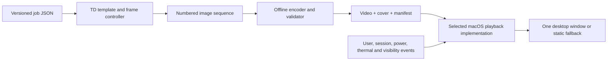

# Implementation plan

Status: **published for user review; independent gpt6astra review completed and its two P2 findings resolved; Claude review pending**. Updated 2026-11-13.

This plan turns the research into an implementation sequence. The current deliverable is the public research repository and this reviewable plan. Product implementation has not started. The existing Swift program is a disposable measurement probe, not the wallpaper application.

The objective is a macOS wallpaper that uses little memory, CPU, and GPU while playing TouchDesigner artwork. TouchDesigner generates the content offline; the everyday playback path uses a local video and native macOS media APIs. Performance is a release criterion, not a claim inferred from the words “native” or “hardware accelerated.”

## 1. Evidence and outstanding questions

| Item | Status | Evidence or next action |
| --- | --- | --- |
| macOS wallpaper mechanisms and public desktop-window approach | Researched | [macOS research](../research/01-macos-dynamic-wallpaper.md) |
| TD deterministic rendering, output options, and license constraints | Researched; not exercised in TD | [TD automation research](../research/02-touchdesigner-video-automation.md) |
| Existing-player implementation patterns | Source-reviewed at pinned commits; applications not benchmarked | [existing applications](../research/04-existing-apps-performance.md) |
| Native video playback and occlusion pause/resume | Four short local pilot runs completed | [performance report](../research/05-performance-feasibility.md) and its raw-data links |
| Whole-system CPU, GPU, helper memory, and long-term stability | **Not accepted** | Noisy baselines, incomplete attribution, no sustained test |
| TouchDesigner template, task runner, final asset, and product player | Not implemented | Milestones below |
| Reuse an existing player or build a small native one | Decision pending | Compare one suitable existing candidate against the same acceptance criteria |
| Independent gpt6astra plan review | Completed; two P2 findings resolved in this plan | Added a WindowServer footprint gate and moved lock-signal feasibility into M1 |
| User plan review and independent Claude review | Pending | Record review results and resulting changes before product implementation |

In the single-run pilots, playback-process CPU was approximately 1.31–1.74% of one core and its physical footprint approximately 15.28–16.38 MiB. These are **process-only observations**, not the total cost of a wallpaper. WindowServer, decoder services, shared surfaces, and GPU work remain material. The existing data do not establish a GPU pass, a battery-life improvement, or a performance ranking of existing applications.

The research describes alternative possibilities; this plan narrows the first implementation. Where an older example uses 30 fps, the default target here is 24 fps.

## 2. First release and scope

The smallest useful result is one repeatable TD visual, a validated local MP4 with a static cover, and a reliable way to display it on one selected screen. TD and FFmpeg are closed during ordinary wallpaper playback.

| Included in the first release | Deferred |
| --- | --- |
| One stateless, periodic visual template; fixed seed and parameters | Stateful particle/feedback simulations and arbitrary template plugins |
| 1280×720 at 24 fps; optional 1920×1080 at 24 fps after license and performance checks | Default 4K, 60/120 fps, HDR, and animated multi-monitor output |
| Local H.264, SDR, no audio; documented color conversion | Streaming, remote downloads, web wallpaper, audio or mouse response |
| One screen, click-through desktop presentation, manual pause/resume and quit | Gallery, accounts, marketplace, cloud queue, automatic updates |
| Independent pause reasons, static fallback, tested sleep/session behavior | Private wallpaper-provider registration and replacement of Apple assets |
| One rendering job at a time; explicit failure and reproducible output records | Render farm, parallel GPU rendering, unattended headless TD service |

Changing Spaces, entering full-screen applications, attaching a display, and removing the selected display must be safe even with single-screen support. The first release need not animate every display. It may stop animation and retain a static fallback when a supported recovery path is unavailable.

Login startup and wider distribution are later conveniences. A first local release must work without modifying login items, system wallpaper databases, or system security settings.

## 3. Intended architecture

The asset boundary is independent of the playback choice. It contains the movie, cover image, dimensions, rational frame rate, frame count, duration derived from frame count/rate, color description, template version, seed, source/build information, and file hashes. The playback process reads completed bundles; it never runs TD or re-encodes content.

If a new player is chosen, begin with AppKit, AVQueuePlayer/AVPlayerLooper, and AVPlayerLayer. Do not start with a custom decoder, frame ring, Metal renderer, or private wallpaper extension. A more complicated pipeline needs a measured benefit that the basic approach cannot provide.

## 4. Reuse-versus-build decision

Write an architecture decision record after controlled playback tests and the M1 lock/unlock signal feasibility spike. It must state the chosen option, candidate versions, evidence, declared lock-support scope, license compatibility, missing behavior, expected maintenance, and reasons for rejecting the alternatives.

Evaluate one appropriate existing player first; the pinned [source comparison](../research/04-existing-apps-performance.md) is a shortlist, not an endorsement. Run the same local fixture, display configuration, visibility conditions, and resource measurements used for the native probe. Record any settings changed by the candidate and how they are restored.

| Choose reuse when | Choose a new native player when |
| --- | --- |
| Local video and required pause policies work reliably | A required policy cannot be configured or fixed with a small maintainable change |
| Its license permits the intended use and integration | License or distribution obligations conflict with the project |
| Whole-system measurements meet the selected profile's budget | The comparable native path meets the budget and the candidate does not |
| It avoids unnecessary services or private integration for our use case | Unneeded dependencies or private behavior dominate maintenance/risk |

An external player can remain an optional dependency; reuse does not automatically mean copying its source. If neither candidate nor probe meets the performance gate, reduce source resolution/FPS or select a static wallpaper. Building a new application is not itself evidence that performance will improve.

## 5. Milestones, deliverables, and checkpoints

### M0 — Research and review package

**Status:** research and four pilot runs complete; independent gpt6astra review completed with its two P2 findings resolved. The public repository has been created, pushed, and verified; user and Claude reviews remain pending. See the [shared checkpoint reports](../agents_shared/README.md).

Deliver a clear root README, this plan, source citations, benchmark source, sanitized results, and milestone reporting conventions under `agents_shared/`. Preserve the limitations of the original measurements. Exclude compiled executables, caches, personal paths, credentials, and unlicensed media from publication.

**Exit:** the repository accurately distinguishes completed work from planned work; links and reproducibility instructions are checked. Record the user review and Claude review as pending until each actually occurs. Resolve review findings or document their disposition. This is the current checkpoint before starting the implementation milestones.

### M1 — Validate measurement and lock-signal feasibility

Improve the existing research harness before developing the product:

1. Record tool/build and fixture hashes, actual display pixels, logical size, scale, refresh rate, power mode, visibility, and relevant background conditions.
2. Add reliable phase timestamps and process identity handling so restarted helpers do not produce invalid cumulative-CPU differences. Keep failed, missing, and unattributed samples explicit.
3. Separate startup, warmup, steady playback, short pause, long pause, and released-player measurements. Keep physical footprint and RSS separate.
4. Establish a quiet, fixed baseline. Preserve a finite run duration, cancellation, and cleanup. The current probe's 120-second cap is insufficient for the proposed sustained protocol: design a bounded longer-run mode as an explicit harness change rather than silently removing the guard.
5. Run a small lock/unlock signal feasibility spike on the target macOS versions, before selecting the playback architecture. Observe supported signals during actual screen locking, unlock, display sleep/wake, and user-session changes. Demonstrate automatic pause on locking and recovery only after all pause reasons clear. Application deactivation, a simulated notification, or manually pausing before locking does not establish automatic lock detection.
6. Reproduce the original short pilot results within an explained range, then collect the controlled runs described below.

**Deliverables:** updated harness, a documented measurement schema, deterministic fixtures, a lock/unlock event-and-behavior report identifying supported signals and tested OS versions, and a report that includes unusable runs and reasons.

**Exit:** actual visible playback is confirmed; the baseline is stable enough to resolve the proposed budget differences; measurements include the playback process, relevant helpers, WindowServer, and an explicitly named GPU measurement method. Otherwise mark the result **inconclusive** and improve the conditions before proceeding. Before M2, either validate automatic lock pause using supported signals during actual locking or explicitly narrow the declared release scope and record that limitation in the architecture decision. Manual pause before locking is a user action, not an automatic-detection fallback that passes this gate.

### M2 — Performance gate and playback decision

Compare the existing-player candidate and native reference with the same 720p24 and 1080p24 assets. Use 1080p30 only as a comparison and 720p15 as a possible fallback. Test full visibility, complete occlusion, short pause, long pause, and resume. A window reported as “partially visible” does not prove a fully visible desktop test.

Apply the [acceptance budgets](#8-performance-acceptance) and complete the reuse-versus-build record, including the M1 lock-signal result and resulting release scope. If the 1080p profile fails but 720p passes, document 720p as the accepted profile instead of relaxing the measurements. The final artistic asset will be tested again later.

**Deliverables:** repeated-run results, chosen operating profile, architecture decision, and unresolved limitations.

**Exit:** whole-system resource evidence supports at least one useful profile, or the project explicitly settles on a static fallback. No GPU or aggregate-memory pass can be inferred from the existing process-only pilot.

### M3 — Deterministic TD asset production

Confirm the installed TD build and license. First use 1280×720 to remain within the Non-Commercial resolution limit; separately confirm whether the intended use is permitted. Existing build `2025.33230` predates the reported `2025.33360` movie-recording fix, so preserve frame-count verification and prefer the image-sequence baseline. Do not upgrade the user's installation merely to satisfy a plan.

Create one small periodic template and a controller that reads a versioned job. The proposed job fields are `schema_version`, `job_id`, template identifier/hash, seed, width, height, FPS, frame count, visual parameters, and an output directory. Validate them before rendering. Use project-relative paths and a unique output directory for each attempt.

Render exactly `N` frames at phase `i/N`, for `i=0…N-1`; omit the duplicate endpoint. All animation comes from the task's frame index, not wall time or `absTime`. Fix seeds and initial state. Use non-realtime progression and wait for each output to be complete; reset all relevant state between jobs.

Use the job states `queued → preparing → rendering → encoding → validating → complete`, with `failed` possible at every stage. The controller yields between frames rather than blocking the TD event loop. Start with numbered images; direct movie export is an optional later optimization.

Define the SDR color conversion before declaring a final asset correct. Verify source sequence continuity, frame count, dimensions, encoding parameters, complete decode, time base, duration, color appearance, and the loop boundary. Compare two runs of the same task on the same machine/build; do not promise bit-identical results across hardware or encoder versions.

**Deliverables:** one `.toe` template, external controller/source files, job example and schema, one final bundle, validation output, and repeatability evidence.

**Exit:** a fresh job reliably produces a playable loop, an invalid/missing frame fails validation, an interrupted render cannot publish a final bundle, and the same task can be reproduced. TD closes before the playback test. See [the prior pipeline research](../research/03-proposed-pipeline.md) for encoding examples, which still need the final color specification.

### M4 — Minimal playback integration

Implement the architecture selected in M2: either configure/adapt the existing application or build the small native host. A new host needs only local asset selection, start/pause, a static fallback, and quit. Avoid a gallery or scheduling UI.

Implement the pause policy and lifecycle described below. Release only this application's resources; restore any setting the implementation changes. An invalid or missing asset shows a usable fallback and a concise error rather than silently consuming resources while displaying nothing.

**Deliverables:** a runnable local application or reproducible existing-player integration, tests for policy decisions, lifecycle logs, and a short user guide.

**Exit:** the actual TD asset plays with TD closed; desktop icons remain usable, focus is not stolen, no sound plays, the system can sleep normally, and every required pause/recovery scenario passes. Re-run resource measurements because product UI and monitoring can change the probe's cost.

### M5 — Sustained validation and first release

Complete the controlled resource matrix and a 30-minute warmed-up memory run with repeated pause/resume and asset replacement. Test invalid media, missing files, display removal, Spaces, full-screen apps, lock/unlock, sleep/wake, and power-policy changes. Use a finite script or recorded manual procedure for each scenario.

Publish a small release only after functional and performance results match its claims. Record the supported OS/build and hardware actually tested, setup/quit instructions, chosen profile, known limitations, provenance, and dependencies. If available, add one less powerful supported Mac; if unavailable, clearly limit compatibility and performance claims to tested hardware.

**Exit:** all required checks for the declared scope pass, or deferred/unsupported behavior is explicit and safe. No login startup, notarization, or public binary distribution is implied by the present documentation-publication task; plan those separately if needed for the chosen release channel.

## 6. Playback policy and lifecycle

Maintain a set of independent pause reasons for the selected screen: `user`, `occluded`, `sessionInactiveOrLocked`, `displaySleeping`, `onBattery`, `lowPower`, and `thermal`. Asset failure and selected-screen loss are separate fault/unavailable states. Playback is allowed only when the asset is ready, a selected screen exists, and the pause set is empty.

Removing one reason never clears another. For example, exposing the desktop must not resume a user-paused or battery-paused wallpaper; waking the display must not resume while the user session is still inactive. Read current conditions when resuming instead of assuming the last notification describes every condition.

| State | Resource behavior | Transition |
| --- | --- | --- |
| Static / unloaded | Cover or configured static fallback; no active movie queue | Load only when playback is permitted |
| Loading | One pending load; previous completion callbacks carry a generation identifier | Ignore stale callbacks after pause, replacement, or quit |
| Playing | Muted native local playback at the asset's normal rate | Any pause reason or failure stops active playback |
| Short pause | Pause media; keep the final frame briefly | Resume only if all reasons clear |
| Long pause | After an initial proposed 30 seconds, release the movie pipeline and retain a static cover | Recreate once on allowed resume; measure the real memory/restart tradeoff |
| Failed / no screen | Release movie resources; display fallback where possible | Explicit retry or validated replacement/screen recovery |

The initial power policy is static on battery and in Low Power Mode. Pause at serious/critical thermal conditions; resume only after policy conditions clear. Exact thermal debounce and long-pause timeout remain parameters to validate, not guarantees of immediate system-buffer reclamation.

Use per-window occlusion, not application-wide visibility: a menu-bar item can keep the application visible. Begin with complete occlusion. Approximate 90% occlusion is optional and deferred unless measurements justify its polling and geometry complexity. If polling becomes necessary, use one shared snapshot, a 2–5 second starting interval with tolerance, and a recovery path that remains alive while paused.

**Lock and sleep are explicit validation requirements, starting with the M1 feasibility spike.** Screen sleep, user-session inactivity, application deactivation, and screen locking are different events. Select documented platform notifications appropriate to the target versions and verify their actual lock/unlock behavior. Do not claim that app deactivation or screen sleep alone detects every lock. If a reliable supported lock signal cannot be established, explicitly narrow the declared release scope before the M2 architecture decision and do not advertise automatic lock pause. A conservative static state/manual resume can be offered as a separately described user workflow, but manually pausing before locking does not validate automatic detection. An undocumented notification must not silently become a production dependency.

The source file sets the frame-rate budget. Produce a true 24/15 fps rendition with unchanged duration rather than slowing `player.rate` or decoding all frames and dropping them afterward. Normal playback stays at rate 1. Avoid per-frame Python, transcoding, and permanent performance sampling in the shipped playback path.

## 7. Functional validation design

Use pure policy tests for combinations of pause reasons, cancellation, and stale load completion. Use integration tests and recorded manual observations for the window server, media pipeline, and system lifecycle; mock notifications alone cannot establish correct macOS behavior.

| Scenario | Required observation |
| --- | --- |
| Fresh launch and repeated loops | Ready layer, advancing media time and loop count, visible motion, no errors or obvious seam/black frame |
| User pause → cover → uncover | Remains paused until the user resumes |
| Cover → battery policy → uncover | Remains static until both policy reasons clear |
| Lock → display sleep → wake → unlock | No premature playback while another reason remains; no claim of lock coverage without testing actual locking |
| Long pause → resume, repeated at least ten times | One recreated pipeline, bounded resource trend, no duplicate windows/players |
| Missing/corrupt file or replacement during load | No final-success claim, no stale callback resurrection, usable fallback |
| Spaces/full-screen transition and selected-display removal | No focus theft, blocking window, orphan playback, or animation on an unintended display |
| Quit during load/play/pause | All owned windows and tasks terminate; no persistent settings left changed |

Resource fixtures include fixed H.264 `testsrc2` profiles and the final slow-moving TD artwork. Keep fixture commands, hashes, stream metadata, and duration. Test patterns measure transport/presentation reliably but do not certify the artistic loop, its color appearance, or every real video's decode cost.

For deterministic export, test exact sequence count and numbering, repeated-task output, deliberate missing/corrupt frames, and a failed encoding attempt. Check that the completion marker appears only after validation and same-filesystem publication of final files. Never reuse an old attempt's frames without an explicit verified recovery rule.

## 8. Performance acceptance

These are **proposed project budgets informed by research and plan review**, not measured guarantees or industry standards. The WindowServer footprint limit is an additional tentative project budget, not a result from the pilots. Confirm them during plan review; change them only with a documented tradeoff. Each accepted profile must pass all applicable measurements.

| Metric | Proposed target | Current status |
| --- | --- | --- |
| Visible single-screen 1080p24 CPU | Mean incremental CPU of player + attributable helpers + WindowServer ≤5 percentage points; one full logical core =100% | Only low player-process CPU observed |
| Paused CPU | Same incremental scope ≤0.5 percentage points; no unnecessary frame-driven work | Only player-process pause observed |
| Player/helper memory | Player + attributable-helper physical footprint ≤200 MiB; record system pressure and peaks | Aggregate footprint unverified |
| WindowServer memory | Steady-state mean incremental physical footprint over its paired static baseline ≤64 MiB in each valid repeat; no sustained growth or added memory pressure | **Unverified; tentative budget requiring footprint measurement and stable attribution** |
| GPU | Mean increment ≤3 percentage points using one fixed same-machine measurement method; pause returns to the measured baseline range | **Unverified; existing background load invalidates a clean attribution** |
| Sustained operation | No persistent post-warmup footprint growth over 30 minutes and repeated lifecycle transitions; no added memory pressure | Not tested |
| Power/lifecycle | Static/paused under default battery policy, no sleep prevention, correct recovery reasons | Actual battery/lock/sleep cases pending |

For a lower accepted profile, record its exact dimensions/FPS and apply the same budgets. The 200 MiB player/helper gate and 64 MiB WindowServer-increment gate are separate accounting checks: do not blindly add them to claim a 264 MiB total, because shared resources can affect attribution and accounting. A memory-slope result requires a documented tolerance based on measurement noise and allocator behavior; a short plateau does not prove the absence of all leaks.

Protocol:

1. Fix the display, brightness, refresh rate, power mode, fixture, and background conditions. Confirm actual full visibility for the visible phase without retaining screenshots of unrelated desktop content.
2. Warm up for 60 seconds, then retain 120 seconds per condition. Alternate near-in-time static baseline, visible play, complete occlusion, pause, and release/recovery conditions. Run at least three valid repeats; counterbalance order where practical.
3. Use cumulative CPU-time deltas over known intervals. Aggregate only helpers that can be attributed; report unassignable services separately. Track process restarts and explain missing samples.
4. Compute interval means and report the minimum/median/maximum across valid repeats, plus within-run variability and descriptive tail samples. Require each valid repeat's mean to meet the stated mean budget; do not average a failure away. Reject contaminated runs with their reason retained.
5. Global GPU counters are whole-machine observations, not per-process usage or watts. Use paired controlled conditions and confirm that the baseline noise is smaller than the acceptance difference. If attribution or resolution is insufficient, the outcome is **inconclusive**, not pass. Add appropriate Instruments/system traces if needed, recording their measurement overhead.
6. Keep footprint, RSS, GPU allocation, and compressed memory as distinct measures. Do not sum unlike/shared accounting to invent a total. Measure the WindowServer footprint increment against its paired static baseline and apply its separate ≤64 MiB steady-mean gate in each valid repeat. Missing helper/WindowServer footprint data or noisy attribution makes the affected memory conclusion **inconclusive**; RSS alone cannot pass a footprint gate.
7. Follow with the 30-minute memory/lifecycle run. Report watts or battery impact only if actually measured with a defensible same-machine protocol; Energy Impact is not watts.

No test may pass merely because the player requested playback. Ready state, advancing media time, loop count, and visibility are required; actual frame presentation smoothness still needs observation or suitable timing instrumentation. This distinction prevents a hidden, stalled, or failed player from producing a misleadingly good result.

## 9. Dependencies, risks, and reproducibility

| Risk or dependency | Mitigation / decision point |
| --- | --- |
| TD license, resolution, and paid-use restrictions | Confirm actual license and intended use before M3; start at 720p; external encoding does not remove TD restrictions |
| TD/macOS/codec-version behavior | Pin tested versions and record source/export checks; treat upgrades as a new validation input |
| Existing application license and maintenance | Review before adoption/copying; retain provenance and required notices; repository licensing is a separate project decision |
| Noisy WindowServer/GPU/helper measurements | M1–M2 gate; stable controlled comparisons; explicitly inconclusive when attribution fails |
| Hidden retained surfaces and caches | Footprint plus helper/system evidence; long pause/release comparison and sustained test |
| Lock/Spaces/full-screen/display edge cases | Real lifecycle matrix; static fallback; no dependence on unverified private behavior |
| Color shift or visible loop boundary | Explicit SDR conversion, test chart, repeated visual loop check, actual playback comparison |
| Rendering interruption or stale output | Unique attempt directories, state machine, complete validation before final publication |
| Battery cost despite low process CPU | System-level measurement and default static power policy |

Record source commit, tool versions, fixture generation commands and hashes, display/power conditions, exact run command, failure status, raw metrics, summarizer version, and conclusions for every accepted measurement. Capture only relevant process names and numeric metrics; avoid full process arguments and desktop contents.

Before publishing results, remove usernames, home paths, host/device identifiers, absolute workspace paths, and incidental private data. Preserve numerical observations and note redactions. Keep local raw data private when required, with a sanitized reproducible report in the repository. Do not commit generated videos, build products, caches, signing material, or third-party assets unless explicitly intended and legally distributable.

## 10. Review and milestone reports

Use `agents_shared/` for a short report at each milestone: objective, files changed, decision, checks actually run, results, unresolved issues, and next step. Include exact tested commits/artifact hashes when relevant. Write “not run” rather than implying that a proposed check passed.

The independent gpt6astra plan review is completed. Its two P2 findings are resolved here: WindowServer now has a separate tentative incremental-footprint acceptance gate, and the actual lock/unlock signal feasibility spike now precedes the playback architecture decision. These are planning corrections, not evidence that either runtime check has passed. User review and Claude review remain pending, and M0 publication remains in progress until repository publication is confirmed.

The Claude review should inspect this plan, research limitations, benchmark methodology, pause-state correctness, lock/sleep assumptions, licensing boundaries, and scope. Record the review date, reviewer/tool and version where available, findings, and disposition. Until it has happened, its status remains **pending**; this plan does not claim external approval.

The present user-requested review checkpoint precedes product implementation. Subsequent milestone checkpoints are evidence and scope reviews, not an invented requirement to seek permission for every routine development action. Apply the user's later implementation authorization and the environment's actual permission rules when work proceeds.
