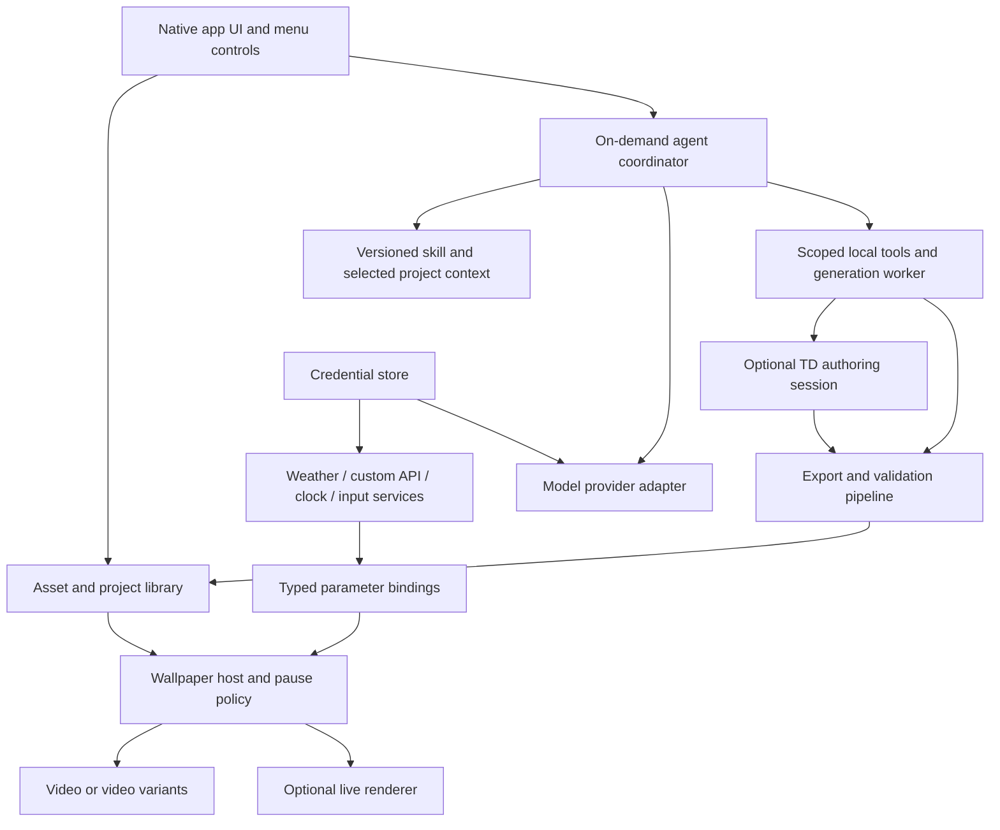

# Agent-assisted wallpaper platform

Scope extension requested 2026-11-17. This document extends the [implementation plan](README.md), rather than replacing the verified disk pipeline or relaxing the low-resource requirement. The [native preview](../app/README.md) now implements a bounded subset: model proposals using shipped skill context, calibrated local generation, editable TD copies, Keychain/selected `.env`, a weather connector and typed custom HTTPS mapping to a constrained native scene. Broader capabilities below remain targets. See [shared status](../agents_shared/README.md) for actual verification. Source feasibility and interoperability limits are in [research/06](../research/06-interactive-agent-platform.md).

## Product outcomes

- A native Mac app starts and plays ordinary local wallpapers without opening TD or invoking a model. Existing low-resource video work remains the first delivery.
- Users connect their own model provider, describe a wallpaper, and let an app-hosted agent read the versioned project skill, clarify material gaps, create/edit a project, validate it, and produce a usable asset.
- “Edit in TouchDesigner” creates an editable copy of a template and opens it on request. A TD connection, installation, license and safe current-project state are checked only when that workflow needs them.
- Wallpapers can bind visual properties to weather, time, mouse/audio input and user-selected APIs. Data updates and rendering remain independent of model generation.
- Wallpaper Engine feature coverage is a long-term product target, tracked with feature-level acceptance. Import/runtime compatibility with existing Workshop content is a separate question; no 100% compatibility claim is justified by the current research.

## App structure and user journeys

The native app has a small library/preview window, a creation conversation, template editing, and connection/settings pages; playback controls remain in the menu bar. UI need not stay open while a wallpaper runs.

**Use an existing wallpaper:** select/import a completed package, inspect its required runtime/data capabilities, apply it to a screen, and pause or quit from the menu bar. Keep an app-owned copy of imported content. An unavailable optional renderer must leave a usable static fallback and explain which dependency is missing.

**Generate with an agent:** choose a configured provider/model, describe the result, answer only unresolved questions, and start the bounded creation job. Show the resulting brief, progress, preview, checks and output. Applying the result is a separate user-visible action; the last working wallpaper remains usable while generation fails or is cancelled. Existing authorization covers routine steps within that task; do not ask for approval after every file/tool operation.

**Edit manually in TD:** duplicate a template into a user project, preserve its source/version identity, expose useful parameters, and open the project without overwriting an unrelated unsaved session. On export, use the same validation and import pipeline as agent-created content. The template source and playback package are separate artifacts.

**Connect an effect to an API:** select a connector/provider, configure the endpoint and credentials, preview a sample response, choose typed fields and map them to declared visual properties. Settings show data freshness, refresh cadence, connection status and fallback. A custom API may need an adapter; entering a URL alone cannot interpret every authentication scheme or response.

## Renderer contract

Use a common lifecycle contract: capability/dependency inspection, load, apply validated parameters, start, pause, release, recover, and report failure. This is a proposed interface, not code that already exists. Keep one selected renderer active per screen by default; unloaded backends must not retain an idle web view, TD engine instance or decoder queue.

| Mode | Execution | TD dependency during playback | Scope / acceptance |
| --- | --- | --- | --- |
| `video` | AVFoundation loop and static cover | None | Existing initial resource budgets; validate loop, color, recovery and release. |
| `video-variants` | Select one pre-rendered clip from data/state | None | First weather example; bounded transitions and hysteresis; do not decode every variant continuously. |
| `native-scene` | A constrained native/Metal scene and property set | None | Optional continuous effects; implement supported primitives explicitly, not a TD network compiler. |
| `web` | Local HTML/CSS/JS in a managed WebKit host | None | Separate process/memory budget, typed bridge and lifecycle tests; WE-specific APIs require explicit compatibility work. |
| `touchengine` | `.tox` hosted via TouchEngine | Installed runtime plus appropriate paid license; no editor window required | Feasibility spike first; license, rendering synchronization, cleanup, crash isolation and resource costs must pass. |
| External TD live bridge | Explicit TD/TouchPlayer session plus texture/control bridge | Running external TD runtime | Advanced opt-in mode; report the entire dependency/cost, never auto-enable at app launch. |

Video remains the lowest-complexity default. Live behavior is part of the requested product scope, so the earlier video-only boundary applies to the first increment, not to the entire product. TouchEngine is a candidate, not the selected implementation of all live features. A runtime-free native scene can be authored alongside a TD reference, but arbitrary `.toe`/`.tox` conversion is not promised.

## Model providers and agent execution

Separate `AgentProvider` transport from `AgentCoordinator` execution. Provider profiles declare endpoint, model identifier, credential reference, supported tool/structured-output/streaming capabilities and timeouts. Start with a small verified provider set; an OpenAI-compatible profile is a compatibility target to test, not universal protocol support. An API profile does not reuse a Claude Code/Codex app login automatically or imply that those clients are installed.

The coordinator loads the pinned skill version and relevant project references into context, and serves additional project reads through tools. In a distributed app, ship the reviewed skill/reference subset and keep versions associated with app/template capabilities; do not assume a Git checkout or private skill directory exists. Do not send the whole home directory or credentials to the model. Store a reproducible brief, source/template identities and redacted task trace with each attempt.

Initial local tools should be narrow: read selected project/skill resources, inspect template capabilities, validate a job, create/edit an attempt-local source file, inspect TD state, render through a known adapter, finalize/verify an artifact, and preview it. Validate paths/arguments and bound each subprocess. Generated code is not trusted simply because a model emitted it: execute it only in the declared generation workspace with the required capabilities; do not give an arbitrary model reply a general shell by default. Import/preview must not execute package install hooks.

Each job has finite tool-call, token and wall-time limits, cancellation, retry limits, visible failures and retained last-good output. Cost estimates are labelled estimates unless provider billing data is available. Provider/network failure must not stop a running wallpaper. On task completion the generation worker can exit; no continuous agent polling is needed for ordinary playback. Task generation may be resource intensive, so its costs are reported separately and do not overlap controlled playback measurements.

## Data connectors, properties and credentials

Define independent app/project package schemas for renderer kind, user properties, data-source bindings, required capabilities, fallback, source references and runtime requirements. Do **not** insert new arbitrary keys into today's strict `jobs/` schema. Existing job v1 remains the video production contract; future app manifests migrate through explicit versions.

Bindings accept typed, bounded data: booleans, enum choices, numbers with units/ranges, colors and bounded strings. A connector validates HTTP status, JSON shape, timestamps and units, normalizes values and handles missing/stale data. Model responses, remote text and API payloads are data, not instructions granting additional tool permissions. Property schemas drive both UI controls and renderer updates; changes should interpolate or use hysteresis rather than repeatedly rebuilding the scene.

Use a native data broker for network access. Connector profiles define destination/authentication, polling limits, timeouts, maximum response size, cache TTL, backoff and offline behavior. Deduplicate identical weather requests across screens. Stop unnecessary polling while asleep; resume with one stale-aware refresh, not a burst of missed polls. Streaming/WebSocket sources need their own adapter and resource policy. Plugins requiring executable adapters run under a separately scoped capability contract, not as arbitrary mapping expressions.

The app stores user-supplied provider/data credentials in Keychain and passes each only to its configured service. Local development supports a selected `.env`; parse it as data, never source it as a shell script. Ship only `.env.example`. Exports, screenshots, logs, prompts and Web/scene parameters contain credential references or normalized fields, not secret values. Redact query/header credentials as well as standard authorization headers. A custom endpoint requires an explicit destination/auth association; redirects must not forward a credential to a different origin. Local/private-network endpoints may be configured deliberately, but a downloaded wallpaper cannot silently enable them.

## First vertical slice: Los Angeles weather

The preview takes the constrained native-scene route: Open-Meteo data drives native gradients, clouds and precipitation with TD closed. It has one real public endpoint fetch plus fixture checks, but no controlled whole-system scene performance pass. The pre-rendered TD weather-variant family described below remains a subsequent authoring deliverable; it has not been generated or silently substituted into the current gradient template.

Input: “Generate a wallpaper whose appearance follows current Los Angeles weather.” Use the city location already specified; no device-location permission is necessary. Record whether “current” means provider model data or a user-selected observation source, plus timezone and units. Start with a personal-development Open-Meteo profile; commercial distribution requires a suitable provider plan and attribution. See the [example configuration](../examples/weather-los-angeles/README.md).

Agent creation produces a brief, editable TD source, a small set of validated clips/covers (clear, cloudy, rain, snow, storm, fog, day/night as appropriate), and a proposed data-to-variant mapping. Exact asset count should avoid redundant combinations. Poll current conditions on a proposed 15-minute cadence, cache them, normalize weather code/daylight, and select a single active clip. No model call, TD launch or video regeneration occurs on each refresh. A later live renderer can use cloud fraction, wind and precipitation intensity as continuous parameters.

A timeout, 401, 429, malformed payload or stale response must not become “clear weather.” Retain recent good data for a documented grace period, then use an offline default/static cover and show stale status in the app. Temperature/wind units and Los Angeles daylight time must be handled explicitly. On battery, default to the selected static cover while retaining data state; scene animation and data freshness are separate decisions.

Acceptance includes deterministic recorded weather cases, day/night transitions, bad/missing units, stale data, rate limiting, offline recovery, no provider key leakage, no weather-triggered model calls, and app relaunch with TD closed. Also run one actual endpoint integration test and a controlled resource comparison before calling this feature complete. Fixtures must be labelled simulated; none are evidence of current LA conditions.

## Delivery order and gates

| Increment | Delivery | Evidence required |
| --- | --- | --- |
| Existing M1–M6 / first local app | Validated TD video, native playback, skill | Preserve current lifecycle/resource gates. Reuse screening still informs playback components; a third-party player alone cannot satisfy the expanded agent/template/data product. |
| M7: creation and connections | App-hosted provider/coordinator, template browser, “Edit in TD,” cancellable generation | Real provider round trip, supported local tools, TD project preservation, bounded cancellation/cost, and working artifact import. |
| M8: properties and data | Typed properties, HTTP connectors, weather video variants, `.env` development contract | Full LA-weather slice above with no TD/model required for updates. |
| M9: live effects | Pick and validate live renderer(s), mouse/audio inputs, clocks and scene bindings | Measured supported effects, dependencies, permissions, click-through versus interactive-region behavior and reliable pause/release. Microphone input is not proof of system-audio capture. |
| M10: broader feature coverage | Multiple screens, schedules/playlists, more editor effects, sharing/import ecosystem | Per-feature/version test matrix, per-screen isolation and total resource measurements. Workshop compatibility has its own decision and tests. |

Do not reinterpret the low-resource requirement as irrelevant when enabling richer features. Keep video budgets unchanged; define each live profile's budget and fallback before accepting it. Report player, WebContent/engine/generation helpers, WindowServer, GPU and data-service costs under the applicable mode. A heavier optional mode must be labelled, selectable and unloadable; it does not inherit a low-cost claim from the video probe.

## Open decisions

- Settled user choice: implement comparable features first; evaluate direct Workshop-content compatibility separately. Do not block the main platform on that research.
- The preview selects a constrained native CoreAnimation weather effect set. Whether it should ship, and which additional TouchEngine/Web/audio/mouse backends to support, still needs representative dependency and resource evidence.
- Anthropic Messages and OpenAI-compatible Chat Completions adapters are implemented against fixtures. A real provider/model trial with an explicitly supplied key remains required; no key is needed to review the design or run local template creation.
- App signing/distribution, third-party SDK/runtime redistribution and actual commercial licensing before a public release. Do not bundle an installed TD/MCP component or runtime merely because it exists locally.
