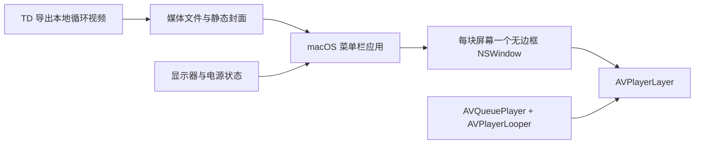

# macOS 动态壁纸实现研究

调研日期：2026-11-10。本文记录初始机制研究，依据 Apple 文档和项目维护者的一手资料；该阶段没有安装壁纸应用、修改系统设置或运行原型。文中的推荐是工程判断，兼容性和功耗需在目标机器上实测。

后续补充：本轮已完成现有程序源码审计和独立原生播放探针，见 [源码核验](04-existing-apps-performance.md) 与 [性能实测](05-performance-feasibility.md)。本篇保留初始机制研究；系统总开销不能依据主进程低 CPU 就判定达标。

本项目建议把 **TouchDesigner 的内容生产** 与 **macOS 的壁纸播放** 分开：TD 先生成可循环视频；第一阶段用现成播放器验证视觉效果。若需自己开发，以公开 AppKit／AVFoundation API 组成的桌面窗口方案为基线；需要系统壁纸选择器和锁屏连续性时，再评估私有原生扩展。只需随昼夜变色的作品，则可另外导出动态 HEIC。

## 1. “动态”有三种不同含义

| 用户看到的效果 | 内容与运行方式 | 对 TD 的要求 |
| --- | --- | --- |
| 一天中明暗、天空、色调逐渐变化 | 多张图片及时间／太阳位置元数据，通常打包为 HEIC | 渲染多个昼夜关键帧 |
| 锁屏或屏保时移动，回到桌面后变为静止画面 | Apple 内置 aerial 的系统转场行为 | 不能假设导出 MP4 后系统就能直接接收 |
| 正常使用桌面时仍持续运动 | 第三方播放器的桌面窗口，或接入系统壁纸扩展 | 渲染无缝循环视频，或提供实时画面 |

Apple 当前帮助将 Dynamic Wallpapers 描述为随所在位置的一天时间变化明暗；Landscape／Cityscape／Underwater／Earth aerials 则在锁定、解锁时动画，并默认同时作为屏保。两者都不能直接等同于持续循环的视频桌面。[Apple：自定义 Mac 壁纸](https://support.apple.com/en-gb/guide/mac-help/mchlp3013/27/mac/27)

## 2. 动态 HEIC：系统负责昼夜切换

开源 `wallpapper` 接收图片和 JSON，支持 Solar、Time、Appearance 三种描述，输出一个 HEIC。Solar 使用太阳高度／方位；Time 使用一天内的时间；Appearance 使用浅色／深色两张图片。这说明可以从同一个 TD 场景抽取“清晨、白昼、黄昏、夜晚”状态，再打包为系统动态壁纸。它是图片状态切换路线，不是 30 fps 视频编码。[wallpapper 用法与源码](https://github.com/mczachurski/wallpapper)

建议先做 4–8 张统一分辨率和构图的关键帧，选择 Time 模式验证，再考虑太阳位置。不要将“生成 HEIC 成功”视为“目标系统已按时间切换成功”：还需要在系统设置中检查动态选项、浅深色行为和时间变化。动态元数据的工具实现可参考，但它不是 Apple 承诺稳定的通用视频壁纸格式。

Apple 的公开 `NSWorkspace.setDesktopImageURL(_:for:options:)` 合约是为某个 `NSScreen` 设置 **image file URL**，要求从主线程调用。它适合设置静态封面，也可作为图片安装能力的基础；该 API 文档没有提供传入 MP4 后持续播放的保证。[Apple：setDesktopImageURL](https://developer.apple.com/documentation/appkit/nsworkspace/setdesktopimageurl%28_%3Afor%3Aoptions%3A%29)

## 3. 持续视频：AppKit 桌面窗口 + AVFoundation

原理是创建位于桌面背景附近的无边框窗口，把播放器图层放进去。它属于本应用的窗口，运行时覆盖底层壁纸；退出后窗口消失。建议结构如下，属于拟议架构：

`AVPlayerLooper` 管理同一个 `AVPlayerItem` 在 `AVQueuePlayer` 中的重复播放。保留 player 和 looper 的生命周期，并处理加载和播放错误。播放器实现重复播放，并不会修复素材自身首尾运动不连续的问题。[Apple：AVPlayerLooper](https://developer.apple.com/documentation/avfoundation/avplayerlooper)

桌面集成需逐项验证：

- **层级**：通过 `CGWindowLevelForKey` 查询桌面相关层级，目标是视频在系统背景之上、Finder 图标之下；不要硬编码负整数。Apple 定义了 desktop level，但“任意版本上与系统壁纸的排序都正确”仍需实测。[Apple：desktopWindow](https://developer.apple.com/documentation/coregraphics/cgwindowlevelkey/desktopwindow?changes=_6&language=objc)
- **鼠标与焦点**：窗口设为鼠标穿透，不成为 key/main window；避免抢走点击、桌面框选和文件拖放。`ignoresMouseEvents` 是对应的公开属性。[Apple：ignoresMouseEvents](https://developer.apple.com/documentation/appkit/nswindow/ignoresmouseevents?changes=_5_5&language=objc)
- **Spaces**：评估 `.canJoinAllSpaces`、`.stationary`、`.ignoresCycle` 的组合；这些行为分别涉及 Spaces、Mission Control 与窗口切换，不能把“所有 Space”误解为应覆盖其他应用的全屏内容。[Apple：CollectionBehavior](https://developer.apple.com/documentation/AppKit/NSWindow/CollectionBehavior-swift.struct?changes=_1)
- **多屏**：每屏维护窗口及播放状态，使用整屏 frame，显式决定裁切／留边；监听显示器连接、分辨率和排列变化后更新布局。[Apple：didChangeScreenParametersNotification](https://developer.apple.com/documentation/appkit/nsapplication/didchangescreenparametersnotification)

[Mural 的架构文档](https://github.com/NoahLaforet/Mural/blob/main/docs/ARCHITECTURE.md) 可作为这一组合的实现参照，但不能当作 Apple 的兼容性保证。不同项目的层级和 Spaces 策略存在差异，应通过桌面图标、Space 切换、Stage Manager、全屏和外接屏测试决定参数。

## 4. 系统原生扩展：已可做到，但使用私有接口

截至调研日，Aerial 官网列出 4.1.10（2026-11-02），要求 macOS 26+，支持导入自己的 `.mov`／`.mp4`，并在系统设置中提供原生壁纸。因此，“macOS 完全无法接入自定义视频壁纸”已经不是准确描述。[Aerial 官网](https://aerialscreensaver.github.io/index.html)

其维护者明确说明：4.1 采用 `com.apple.wallpaper` 扩展点，依赖 **私有 `WallpaperExtensionKit`**，生命周期和远程 `CAContext` 渲染也未公开文档化。这能让第三方内容进入系统壁纸／屏保流程，却不等于 Apple 已提供稳定、公开的第三方视频壁纸 SDK。[Aerial 技术说明](https://github.com/AerialScreensaver/Aerial/blob/main/README.md)

Phosphene 的主仓库也声明依赖私有 `WallpaperExtensionKit`，支持从系统设置选择视频、桌面及锁屏播放，macOS 更新可能改变这些接口。[Phosphene 主仓库](https://github.com/kageroumado/phosphene)

对本项目的判断：若目标是尽快把 TD 作品用起来，先用现成应用验证导出文件更划算；若要开发完整原生产品，扩展方案应单独评估系统版本、签名／分发、沙箱内文件共享、帧解码和升级维护成本。不要直接把桌面窗口中的 `AVPlayerLayer` 方案搬进扩展，二者的宿主和渲染生命周期不同。

“视频自动生成”和“自动设为系统壁纸”也是两个问题。Aerial 使用的 PaperSaver 通过未文档化的 wallpaper store 写入、重启 WallpaperAgent、回读与回滚来选择扩展。此工具可以研究，但不能把它当作公开 API 的一键安装接口，首轮宜由用户在系统设置选择已注册的壁纸。[PaperSaver 实现说明](https://github.com/AerialScreensaver/PaperSaver)

## 5. 省电和系统生命周期是必要功能

以下是实现要求，不是已测得的效果：

| 条件 | 建议行为 | 依据 |
| --- | --- | --- |
| 屏幕睡眠 | 停止播放；唤醒后根据当前状态恢复 | [NSWorkspace.screensDidSleepNotification](https://developer.apple.com/documentation/appkit/nsworkspace/screensdidsleepnotification?changes=_3)，需在 workspace 的 notificationCenter 订阅 |
| 低电量模式或高热状态 | 暂停或切换较低分辨率／帧率的预渲染版本 | [ProcessInfo](https://developer.apple.com/documentation/foundation/processinfo) 提供低电量模式和 thermalState |
| 桌面被完全遮挡 | 经过验证后暂停该屏幕；不要只凭应用是否前台判断 | [NSWindow.OcclusionState](https://developer.apple.com/documentation/appkit/nswindow/occlusionstate-swift.struct?changes=_7%2C_7) 定义可见性，但桌面层窗口的实际行为仍需验证 |
| 用户没有操作 | 不因壁纸视频阻止自动休眠 | [AVPlayer.preventsDisplaySleepDuringVideoPlayback](https://developer.apple.com/documentation/avfoundation/avplayer/preventsdisplaysleepduringvideoplayback?changes=l_3) 在 macOS 默认就是 false，可显式保持 false |

不要预先承诺“零 CPU”或固定百分比。测量应比较同一机器上的静态壁纸、视频可见、视频遮挡和低电量状态，记录 CPU、GPU、Energy Impact、内存、解码卡顿及休眠恢复。常驻 TD 实时渲染和预渲染视频播放也要分别测量。

## 6. 路线选择与下一步实验

| 路线 | 适用目标 | 本项目优先级 |
| --- | --- | --- |
| TD 关键帧 → 动态 HEIC | 日夜变化、低运行负担 | 并行的静态交付选项 |
| TD 视频 → 已有播放器 | 尽快验证视觉、循环和功耗 | 第一阶段 |
| TD 视频 → 自研桌面窗口播放器 | 需要自己的播放控制，主要覆盖桌面 | 第二阶段候选 |
| TD 视频 → 私有原生壁纸扩展 | 系统选择器、锁屏连续性和原生生命周期 | 单独技术验证后决定 |
| TD 常驻实时输出 → 自研显示层 | 必须响应声音、鼠标或实时数据 | 确认确有交互需求后再做 |

第一轮可用同一段 10–20 秒无声、恒定帧率的 TD 循环视频：先普通播放器确认画面和首尾衔接，再验证桌面、双屏、Spaces、全屏、锁屏／解锁、睡眠／唤醒与电源切换。通过后再把导入与切换纳入自动化。

替换 Apple 的缓存视频、修改 wallpaper 数据库／manifest、频繁重启 WallpaperAgent，以及网上流传的 ScreenSaverEngine 桌面启动技巧，应视为各自版本的实验性接入，不能作为可维护主方案。原生私有扩展同样要承认兼容性成本，但应与“覆盖系统素材文件”的办法区分开。

当前未验证：本机所有 Spaces 的显示行为、所选播放器的自动导入接口、实际功耗、动态 HEIC 的系统选项、私有扩展的签名与升级兼容性。本次交付是研究结果，不代表这些实验已经通过。
