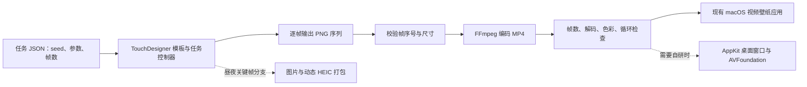

# 从 TouchDesigner 到 macOS 壁纸：建议验证路线

研究日期：2026-11-10。本文是项目方案和验收设计，尚未创建 TouchDesigner 工程或成品壁纸播放器。

性能优先补充：独立的播放探针已完成四组短测，结果见 [低资源可行性核验](05-performance-feasibility.md)。当前默认候选改为单屏 720p/1080p、24 fps；本篇 30 fps / 600 帧示例保留用于导出流程说明。正式作品进入常驻播放前，必须通过性能门槛。

## 1. 建议先实现的闭环

先用 TouchDesigner 离线生成可重复的视频素材，再由 macOS 播放器负责桌面展示。这样创作工程可以在导出完成后关闭；渲染与日常播放的资源消耗可以分别测量。



采用图像序列作为首个可靠性基准；单个工程通过验收后，再评估直接录制视频以节省磁盘空间。图像序列能够检查漏帧，也能在不重新计算视觉效果的情况下调整编码参数。Movie File Out TOP 支持视频与图像序列，详见 [TD 自动化研究](02-touchdesigner-video-automation.md)。这是一项工程选择，不表示所有项目都必须经由 PNG。

壁纸接入先手动导入现有视频壁纸应用，验证成片；若需要自己的播放控制，再用公开 AppKit / AVFoundation API 做桌面窗口。需要系统壁纸选择器或锁屏衔接时，可单独验证 Aerial 等私有壁纸扩展路线，参见 [macOS 研究](01-macos-dynamic-wallpaper.md)。

## 2. 本机已核对的条件

以下是本次只读检查结果，不是最新版本声明，也不是完整兼容性认证。

| 项目 | 检查结果 | 对下一步的影响 |
|---|---|---|
| 系统 | 本机报告 macOS `27.2.1`，`arm64` | 桌面层级、Spaces、锁屏仍需在此机实测 |
| TouchDesigner | `/Applications/TouchDesigner.app`，版本 `2025.33230` | 可使用现有安装；后续文档必须对照这个 build |
| TD 许可证 | 尚未读取或核实 | 原型先按 Non-Commercial 的 1280×1280 上限规划；商业用途另核许可证 |
| FFmpeg / ffprobe | 均为 `9.0.2`，可从当前 PATH 调用 | 可在 TD 外编码和检查产物 |
| 编码器清单 | 包含 `libx264`、`h264_videotoolbox`、`hevc_videotoolbox`、ProRes、PNG | 只验证了下面的 `libx264` 样例，硬件编码尚未运行验证 |
| TD 自动化连接 | 本次会话未发现可调用的 TD 专用连接工具 | 方案使用工程内 Python/DAT 与磁盘文件，不依赖某个特定 MCP 服务 |

本次未启动或修改 TD 工程、切换系统壁纸、安装软件、修改登录项。TD 许可证状态与运行中的节点状态尚未验证。

## 3. 任务契约与目录约定

建议每个任务一份 JSON，先只允许一个渲染任务运行。下面的字段是**本项目拟定的协议**，不是 TouchDesigner 自带参数或已经存在的脚本。

```json
{
  "schema_version": 1,
  "job_id": "gradient_seed42_720p_30fps",
  "template": "td/wallpaper_template.toe",
  "seed": 42,
  "width": 1280,
  "height": 720,
  "fps": 30,
  "frame_count": 600,
  "parameters": {
    "palette": "dusk",
    "motion_cycles": 1
  },
  "intermediate": "png",
  "output_dir": "renders/gradient_seed42_720p_30fps"
}
```

持续时间由 `frame_count / fps` 得到，此例为 20 秒，不再另存一个可能冲突的时长。路径以项目根目录为基准。每个任务的输出目录包含帧序列、预览图、视频、状态、日志及最终清单；实际 build、模板和配置内容的哈希也应记入清单。

建议状态机：`queued → preparing → rendering → encoding → validating → complete`，任何阶段可进入 `failed`。开始前验证尺寸、帧数、许可证、磁盘空间与输出目录；成功标志只能在视频关闭写入并通过验证后产生。临时产物和最终文件分开，同一文件系统内完成重命名，再发布完成状态。重试使用新目录或明确的恢复规则，避免把上次残留帧混进本次视频。

先固定一个 `.toe` 模板和一个队列。外部 Python 负责选任务、启动/监控、超时与编码；TD 内部控制器负责加载配置、设置场景、渲染和提交状态。不能把普通 Python 进程当作已拥有 TD 的 `op()` 环境，也不能把可从命令行启动误认为支持无图形会话渲染。

## 4. 循环与可重复性

对第 `k` 帧采用 `p = k / N`，其中 `k = 0 … N-1`。例如用 `sin(2πp)`、`cos(2πp)`驱动周期参数，输出 600 帧时最后采样点为 `599/600`，不要额外输出 `p=1` 的重复起点。

这个条件只保证相位周期；所有运动、随机采样、噪声域、色彩变化和模拟状态也要闭合。固定 seed 不足以让任意粒子或反馈系统自动成为循环；预热也不保证首尾相接。首个原型宜采用无历史状态的周期图形，确认管线后再增加 Feedback、粒子和状态模拟。

动画由帧索引驱动，避免依赖墙钟、鼠标、直播音频或网络返回时间。相同配置应在同一个 TD build 和机器上重现；跨 GPU、驱动或 TD 版本的逐像素一致性需另测。

验收首尾时应比较“末帧到首帧”的变化与普通相邻帧变化，并观看连续多轮播放。要求首尾两张图完全相同，反而可能导致重复一帧的停顿。

## 5. 可复用的编码与检查命令

以下从项目根目录执行。假设源目录已包含且仅包含连续的 `frame_000001.png` 到 `frame_000600.png`，尺寸一致、宽高为偶数。**编码前先检查序列数量与连续性**；`-frames:v 600` 只是输出上限，不能代替源序列校验。

```sh
ffmpeg -hide_banner -n \
  -framerate 30 -start_number 1 \
  -i 'renders/gradient_seed42_720p_30fps/frames/frame_%06d.png' \
  -frames:v 600 -an \
  -c:v libx264 -preset medium -crf 18 -pix_fmt yuv420p \
  -movflags +faststart \
  'renders/gradient_seed42_720p_30fps/loop.partial.mp4'
```

`-framerate` 指定图像序列的输入时间基准；不能在这里依赖默认帧率，或用输出 `-r` 补帧来掩盖漏帧。`-n` 防止覆盖已有文件。CRF 18、30 fps 是起步参数，不是测出的最佳功耗或体积配置。[FFmpeg image2 文档](https://ffmpeg.org/ffmpeg-formats.html#image2)、[命令行文档](https://ffmpeg.org/ffmpeg.html)、[libx264 文档](https://ffmpeg.org/ffmpeg-codecs.html#libx264_002c-libx264rgb)

```sh
ffprobe -v error -count_frames \
  -show_entries 'stream=codec_type,codec_name,width,height,pix_fmt,r_frame_rate,avg_frame_rate,nb_read_frames:format=duration' \
  -of json 'renders/gradient_seed42_720p_30fps/loop.partial.mp4'

ffmpeg -v error -xerror \
  -i 'renders/gradient_seed42_720p_30fps/loop.partial.mp4' \
  -f null -
```

预期是一条 H.264 视频流、无音频，`1280×720`、`yuv420p`、30 fps、600 个解码帧、约 20 秒，并且全片解码无错误。`nb_read_frames` 比仅相信容器声明的帧数更有用；它仍不能证明每帧内容都不重复，或证明画面无接缝。[ffprobe 文档](https://ffmpeg.org/ffprobe.html)

全部验收通过后，才在同一目录把 `loop.partial.mp4` 重命名为 `loop.mp4`，并发布成功状态。失败时保留临时文件供排查；重试使用新的任务目录，避免覆盖或误发布旧产物。

**色彩边界：**上面的命令用于验证帧序列到 MP4 的流程，尚未定义完整交付色彩方案。正式导出要明确 TD 工作空间、输出传递函数、RGB→YUV 矩阵及 full/limited range，在 TD、QuickTime 和实际壁纸窗口中对照测试图。线性 EXR/ACES 不能直接按普通 SDR PNG 处理；只补写 BT.709 标签也不等于做了颜色转换。最终选定 SDR Rec.709 流程后再固定转换和元数据参数。[FFmpeg 色彩转换文档](https://ffmpeg.org/ffmpeg-filters.html#colorspace)

### 本次实际验证

已在临时目录生成 60 张 `320×180` 的合成 PNG，按上述编码参数生成 30 fps MP4，并用同样的探测/解码方式检查：H.264、`yuv420p`、60 帧、2.000000 秒、无音频，全片解码退出码 0。临时文件已清理。

这次编码实验只证明本机的 FFmpeg 命令路径和小样本编码可用；未验证 TD 逐帧导出、20 秒真实场景、色彩一致性或无缝循环。后续 AVFoundation 短时播放与遮挡实验见 [性能可行性报告](05-performance-feasibility.md)，不能用该结果代替 TD 真实场景或完整桌面生命周期验收。

## 6. 分阶段验证与验收

| 阶段 | 工作 | 通过条件 |
|---|---|---|
| A：最小渲染 | 一个周期渐变/几何场景，1280×720，30 fps，20 秒，固定 seed | 恰好 600 张连续帧；两次任务结果可解释且可重现 |
| B：可用视频 | 编码 MP4，输出预览与元信息 | 解码成功；多轮播放无黑帧/明显停顿；色彩对照通过 |
| C：桌面播放 | 导入现有播放器；若选择自研则每屏一个桌面窗口 | 关闭 TD 后仍播放；图标可点击、不抢焦点、显示器插拔和 Spaces 切换正常 |
| D：后台运行 | 电池/低电量策略、睡眠唤醒、异常恢复 | 不阻止熄屏；恢复后不黑屏、不累积多个播放器；记录实测资源开销 |
| E：批量生成 | 扫描 seed/配色/周期参数，生成多个任务 | 单任务失败可定位和重试；最终清单能追溯工程与参数 |
| F：可选扩展 | 4K、昼夜 HEIC，或原生私有壁纸扩展 | 分别验证许可证、格式、兼容性，不借用 C 阶段结果代替 |

先比较静态桌面、播放器暂停、720p30 和更高分辨率的相同场景，记录 CPU、WindowServer、内存与能耗趋势；已有短时探针结果仍不足以支持“系统整体开销低”或“耗电很低”的承诺。首版不需要实时运行 TD；只有确定需要音频响应、鼠标互动或持续外部数据时，再研究实时输出路径。

本节保留初期 30 fps 示例；当前首版范围和 720p24 默认配置以 [实施计划](../plan/README.md) 为准。下一次实施应先解决性能验证中仍不足的系统总开销与长期内存证据，再按 A 确认许可证和 TD 参数、制作确定性循环。复用现有播放器或开发自己的应用，都使用同一套资源预算和暂停／恢复验收，不能仅凭“原生”或“硬件解码”选择。
